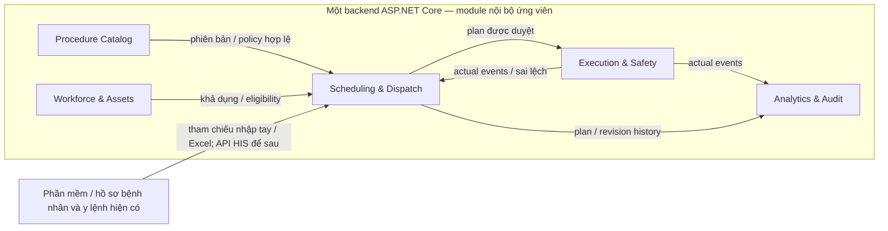

# Discovery ClinicFlow v2 và phạm vi MVP

| Thuộc tính | Giá trị |
| --- | --- |
| ID / phiên bản | DISC-CLINICFLOW-001 / 0.7 |
| Trạng thái | Draft discovery; chưa là baseline nghiệm thu G2 hoặc thiết kế sản phẩm được duyệt G3 |
| Ngày ghi | 12/11/2026, Asia/Saigon |
| Owner | Chủ dự án; các owner phía phòng khám bên dưới là vai trò cần xác nhận, không phải người đã ký |
| Cách đọc | Mục 1: quyết định; mục 13–18: hành vi/cấu hình/quyền; mục 19: khung một tháng và kết quả nội bộ; nguồn và chi tiết tra trong các bảng tương ứng |

## 1. Quyết định đã có

**DEC-PRODUCT-001:** chủ dự án đã chọn “MVP: Lead xếp lịch có kiểm tra; engine tối ưu ở Phase 2 (đề xuất)” trong câu hỏi xử lý mâu thuẫn giữa tổng quan cũ và Backlog_V2. Đây là quyết định scope nội bộ của dự án, không phải phê duyệt quy tắc lâm sàng, UAT hoặc xác nhận phía khách hàng đã ký.

**DEC-PRODUCT-002 / D01:** người dùng đã chọn “Người phụ trách chính của lượt điều trị COMPLETED gần nhất (đề xuất)”. Quy ước nhân viên cũ của MVP vì vậy theo primary của phiên hoàn tất gần nhất, không theo người khám, người thao tác cuối hoặc người thực hiện từng thủ thuật. Các kiểm tra khả dụng/chuyên môn hiện tại vẫn là bước riêng. Nguồn quyết định là câu trả lời trong cuộc trao đổi; ngày ghi nhận 12/11/2026, Asia/Saigon, không suy đoán thời điểm gửi hoặc lời chấp thuận của cơ sở.

**DEC-PRODUCT-003 / D07:** người dùng chọn nhập tay hoặc import Excel vì chưa được khảo sát trước phần mềm hiện hữu. MVP hỗ trợ cả hai kênh; không phụ thuộc API HIS để nhận dữ liệu. Nguồn mã bệnh nhân, cách đối chiếu mã và quyền/trạng thái y lệnh vẫn cần làm rõ; phần API/đồng bộ HIS được khảo sát sau, không coi toàn bộ D07 đã đóng.

**DEC-PRODUCT-004 / D02:** theo mô tả người dùng, nhân viên có thể nhận bệnh nhân tiếp theo, làm công việc được giao và quay lại kiểm tra máy trong khi vẫn chịu trách nhiệm theo dõi. Người dùng xác nhận thêm: “Giới hạn này sẽ được thêm vào config của ứng dụng cho linh hoạt nhé”. Giới hạn số bệnh nhân được theo dõi đồng thời vì vậy là cấu hình, không là hằng số trong code. Trị số/phạm vi áp dụng, tần suất/thời gian kiểm tra và điều kiện phải ngừng nhận thêm ca chưa xác định; không suy ra năng lực vô hạn hoặc xác nhận SOP phía cơ sở.

**DEC-PRODUCT-005 / D03:** người dùng chọn “Chưa có; cấu hình linh hoạt, chờ xác nhận (đề xuất)”. Các bước chuẩn bị, kết thúc và vệ sinh phải cấu hình được; người thực hiện, nhu cầu tài nguyên và thời lượng cụ thể còn chờ phòng khám xác nhận. Không gán giá trị thiếu thành 0 phút hoặc coi giai đoạn máy kết thúc là mọi tài nguyên đã sẵn sàng.

**DEC-PRODUCT-006 / D05:** người dùng trả lời “Cho phép vào config của ứng dụng để có thể linh hoạt triển khai cho phòng khám áp dụng luôn nhé” cho đề xuất cấu hình riêng thời lượng đệm và tài nguyên áp dụng (nhân viên/giường/máy). Chốt khả năng cấu hình trong ứng dụng để phòng khám thiết lập; các trị số/phạm vi thực tế chưa được cung cấp. Các ví dụ 1/2 phút trong tài liệu nguồn vẫn là đầu vào chờ xác nhận, không tự thành mặc định triển khai.

**DEC-PRODUCT-007 / D06–D08:** người dùng chọn “Tách quyền, cho phép kiêm nhiệm (đề xuất)”. Quyền xác nhận cấu hình chuyên môn của **Medical Lead** khác quyền lập/duyệt lịch của **Team Lead**; một người có thể được cơ sở giao cả hai vai trò. Không bắt buộc hai người khác nhau, không tự cấp thêm quyền cho vai trò chỉ có một chức năng. Các quyền intake/dữ liệu và chính sách override khác vẫn cần đặc tả riêng.

**DEC-PRODUCT-008 / D09:** người dùng chọn “Chỉ gợi ý; Lead quyết định có chờ hay không (đề xuất)”. Ưu tiên nhân viên cũ trong MVP là gợi ý để Lead chọn người khác đủ điều kiện hoặc chủ động chọn chờ; hệ thống không tự giữ lượt, trì hoãn hay đặt giữ chỗ chỉ vì người cũ đang bận. Việc Lead chọn chờ vẫn phải đi qua kiểm tra và duyệt lịch thông thường.

**DEC-PRODUCT-009 / D12:** người dùng dự kiến tập trung triển khai liên tục trong một tháng và tận dụng thời gian làm việc cho dự án. Dùng một tháng làm khung lập kế hoạch; chưa quy đổi thành số giờ/tuần, chưa tự đặt ngày bắt đầu/kết thúc, budget hoặc cam kết chắc chắn hoàn thành mọi hạng mục.

**DEC-PRODUCT-010 / mục tiêu tháng đầu:** người dùng chọn “MVP chạy được, nghiệm thu nội bộ (đề xuất)”. Đích của khung tháng là bản MVP chạy được và có bằng chứng kiểm thử/nghiệm thu nội bộ; các giá trị/SOP thực tế còn thiếu có thể được mô phỏng rõ nhãn trong môi trường nội bộ. Mốc này không bao gồm tự đưa vào sử dụng thực tế tại phòng khám hoặc ghi UAT khách hàng đã hoàn thành.

Giữ kiến trúc một backend modular monolith + Clean Architecture + DDD và React/Vite/TypeScript theo cấu hình hiện hành. Một người phát triển phần mềm không đồng nghĩa ứng dụng chỉ có một vai trò sử dụng: tài liệu nêu Owner, Team Lead, Medical Lead, Practitioner, Front Desk và Admin với quyền khác nhau.

MVP có thể chuẩn bị danh mục, nhân sự/tài sản, đầu vào lượt, lịch do Lead chọn, kiểm tra xung đột, theo dõi và báo cáo cơ bản. Tính hợp lệ của lịch vẫn cần cấu hình/SOP đầy đủ; quyết định hoãn optimizer không cho phép bỏ các kiểm soát an toàn hoặc suy đoán dữ kiện thiếu.

## 2. Nguồn và mức độ tin cậy

| ID | Nguồn hiện có | Cách dùng và giới hạn |
| --- | --- | --- |
| SRC-DOCX-V2 | [Phân tích và thiết kế v2](../ClinicFlow_Phan_tich_nghiep_vu_va_Thiet_ke_he_thong_v2.docx) | 630 block văn bản/dòng bảng, 36 bảng; 33 mục chính; phần bổ sung 13–33 vẫn ghi khảo sát/chưa phê duyệt |
| SRC-PDF-V2 | [Bản PDF v2](../ClinicFlow_Phan_tich_nghiep_vu_v2.pdf) | 27 trang; bản trình bày cùng họ tài liệu, không phải bằng chứng xác nhận độc lập từ khách hàng |
| SRC-XLSX-V2 | [EPICS mở rộng v2](../ClinicFlow_EPICS_Phase123_MoRong_v2.xlsx) | 19 sheet: 9 sheet cũ và 10 sheet bổ sung; các backlog/rule/decision vẫn có nhãn đề xuất hoặc chờ xác nhận |

[Source inventory có hash và cấu trúc](source-inventory.json). Các locator Pxxxx/TxxxRxxx chỉ số đoạn và bảng/dòng theo thứ tự body DOCX; kèm tên mục để tra trong Word. Sheet và cell là vị trí Excel thật, trang PDF tính từ 1. Không sửa các file nguồn.

Bổ sung tham khảo: file local `Docs/ClinicFlow_Demo_v2.html` mới có trong workspace. Đã xem metadata/bootstrap, chưa review toàn bộ workflow/UI; local storage và ba role của demo không thay các quyết định hiện hành. File giữ nguyên, chưa được Git theo dõi và không thuộc checkpoint đề xuất. Ba hash trong inventory bên trên vẫn thuộc DOCX/PDF/XLSX đã đối chiếu, không giả định demo đã được chốt làm baseline giao diện.

Đã đối chiếu văn bản: cả 199 đoạn DOCX có ít nhất 50 ký tự sau chuẩn hóa đều tìm được trong text PDF; các heading bổ sung cũng có mặt. Đây là kiểm tra nhất quán văn bản, không chứng minh byte/layout hoặc mọi hình ảnh giống nhau. Đã xem trực quan trang PDF 17 (ERD/trạng thái) và 20 (timeline/điều kiện mô phỏng).

Các con số 10 giường/10 nhân viên/10 máy, 5+20 phút, 15 phút, 20 phút và đệm 1/2 phút là thông tin nguồn ghi khách đã nêu, chưa đủ mô tả vận hành đầy đủ. Mẫu timeline được ghi rõ là giả lập. Các viện dẫn chuyên môn/pháp lý trong nguồn chưa được xác minh phạm vi áp dụng ở bước discovery này; không chuyển thành logic chuyên môn tự động.

## 3. Những điểm cần phân biệt giữa các phiên bản

| Điểm | Bằng chứng nguồn | Xử lý |
| --- | --- | --- |
| Tự động điều phối ở MVP hay Phase 2 | Excel `00 Tong quan!A20:D20` đặt tự động ở MVP, `Backlog_V2!A12:E12`/DOCX mục 25 bảng T030R010 đặt tối ưu ở Phase 2 | Đã giải quyết scope bằng DEC-PRODUCT-001: Phase 2 |
| Nội dung mở đầu vẫn nói workbook 9 sheet và tên file cũ | PDF trang 1; workbook thực tế có 19 sheet và tên v2 hiện hành | Dùng file/hash hiện có; giữ 9 sheet cũ như lịch sử nguồn, không tự xóa hoặc coi mọi nội dung cũ đã bị bác bỏ |
| “DA BIET” không phải chữ ký duyệt | `V2_TongQuan!C4:C6`; DOCX P0102; Excel `00 Tong quan!A3` | Ghi Reported/đã nêu trong nguồn, không ghi Customer Approved |
| Nguồn v2 để mở định nghĩa nhân viên cũ | DOCX mục 17.1 T020R002–R004; `DecisionLog_12!A4:G4` | D01 đã được người dùng chốt theo phương án A tại DEC-PRODUCT-002; file nguồn vẫn giữ nguyên trạng thái khảo sát ban đầu |
| Máy chạy không mặc nhiên giải phóng nhân viên | PDF trang 20; DOCX mục 19.1 T024R004 và mục 28 D02; DEC-PRODUCT-004 | Cho phép công việc khác xen kẽ nhưng vẫn theo dõi; giới hạn đồng thời cấu hình được, còn trị số và nhịp kiểm tra; không dùng 20 phút máy làm khoảng rảnh vô điều kiện |
| API minh họa không là điều kiện bắt buộc cho intake MVP | DOCX T015R007, T028R002–R004; Excel DecisionLog_12 A10:E10; DEC-PRODUCT-003 | Nhập tay hoặc Excel trước; chưa biết API HIS và nguồn mã thực tế, không suy ra đã có đồng bộ |
| Các entity/API là đề xuất thiết kế | DOCX mục 18 và 22; `Entities_36`, `Backlog_V2` | Không scaffold 36 entity hoặc coi endpoint minh họa là API HIS đã tồn tại |

## 4. Thuật ngữ và actor

**Lượt đến (Visit)** khác **Lượt điều trị (TreatmentSession)**; một người bệnh có nhiều lượt đến, một lượt có thể liên quan nhiều phiên điều phối. **Y lệnh tham chiếu (ClinicalOrderRef)** là đầu vào có thẩm quyền; ClinicFlow không tự chỉ định hoặc chẩn đoán.

**Thủ thuật (Procedure)** có **Phiên bản thủ thuật (ProcedureVersion)** và **Công đoạn (ProcedureStep)**. Thời lượng từng loại chiếm dụng, **Giám sát (Monitor Duty)**, **Kết thúc thủ thuật (Closeout)** và **Thời gian đệm (Buffer)** không được gộp thành một duration duy nhất rồi suy diễn khả dụng.

**Team Lead** điều phối và duyệt lịch; **Medical Lead** được đề xuất xác nhận các quy tắc chuyên môn. **Nhân viên cũ (Previous Staff)** đã được chốt cho MVP là primary của phiên COMPLETED gần nhất. Xem [glossary nghiệp vụ](../../glossary/business.md).

Nguồn actor: DOCX mục 16 bảng T018R002–R007 và Excel `Roles_TeamLead!A4:D9`. Các vai trò này khác vai trò PM/QA/developer do chủ dự án kiêm nhiệm trong quy trình phát triển.

## 5. Phạm vi MVP và chuỗi triển khai đề xuất

Các EP01–EP08 dưới đây lấy từ `Backlog_V2!A4:E11`, đối chiếu DOCX mục 25 T030R002–R009. Quyết định MVP đã xác nhận hướng manual/checked; AC và SOP chi tiết vẫn Draft.

| Nhóm | Kết quả cần giao | Điều kiện trước thực hiện |
| --- | --- | --- |
| EP01 — Danh mục động | Danh mục/version/steps/nhu cầu tài nguyên; cấu hình chuẩn bị/kết thúc/vệ sinh và đệm theo DEC-PRODUCT-005/006 | Quyền phê duyệt, dữ liệu/SOP và các giá trị áp dụng thực tế; không hard-code ba thủ thuật hoặc định mức chưa được xác nhận |
| EP02–EP03 — Nhân sự, giường, máy | Ca/vắng mặt/khả năng thực hiện, trạng thái và thời gian khả dụng | Danh sách/ca mẫu, scope chuyên môn, capacity và bảo trì |
| EP04 — Lượt và tham chiếu | Nhập tay hoặc Excel cho mã bệnh nhân/lượt/y lệnh tối thiểu, trạng thái nguồn | Kênh MVP đã chốt DEC-PRODUCT-003; còn mapping mã, quyền, kiểm tra dữ liệu và trạng thái y lệnh; không phụ thuộc API HIS |
| EP05 — Lịch thủ công có kiểm tra | Lead chọn nguồn lực, xem xung đột, duyệt và giữ chỗ atomic | Hard constraints, buffers, monitoring/closeout và chính sách nhiều người duyệt |
| EP06 — Continuity | Gợi ý primary của phiên COMPLETED gần nhất; Lead quyết định chọn người khác hay chờ, không tự giữ lượt | D01/D09 đã chốt DEC-PRODUCT-002/008; còn khả dụng và quyền chi tiết, không override hard constraints |
| EP07 — Theo dõi thực tế | Start/stop/complete có thẩm quyền, planned khác actual | State transitions, closeout/release tài nguyên và quyền cập nhật |
| EP08 — Báo cáo cơ bản | Số lượt, chờ, utilization và continuity từ sự kiện thật | Định nghĩa KPI/denominator/visibility và dữ liệu actual đáng tin cậy |

EP09–EP11 (optimizer, tái điều phối nâng cao, tổ hợp phức tạp) ở Phase 2; EP12 phân tích sâu ở Phase 3. EP13 tích hợp HIS hai chiều phụ thuộc nhà cung cấp, không cam kết đưa vào MVP mặc định. Nguồn: `Backlog_V2!A12:E16`.

Đề xuất lát cắt thực hiện sau khi đủ đầu vào: foundation kỹ thuật -> danh mục/resource và cấu hình đủ điều kiện -> nhận lượt có chỉ định hợp lệ -> Lead tạo/duyệt lịch có kiểm tra -> actual execution -> báo cáo. Chưa coi đây là kế hoạch thời gian hoặc xác nhận mọi prerequisite đã đạt. Khung 15 tuần trong workbook tự ghi là bản nháp, không là deadline cam kết.

## 6. Bounded context ứng viên trong cùng backend

Theo DOCX mục 14.1 T016R002–R008, các module sau là **Bounded Context** ứng viên để rà soát, không phải microservices và không phải quyết định G3 đã được chốt.

| Context | Ownership và hợp đồng dự kiến | Không sở hữu |
| --- | --- | --- |
| Procedure Catalog | Procedure/version/step, yêu cầu tài nguyên và policy được phê duyệt | Chẩn đoán/y lệnh do phần mềm tự tạo |
| Workforce & Assets | Nhân sự/qualifications/shifts, giường/thiết bị/bảo trì; cung cấp khả dụng/eligibility | Truy cập trực tiếp bảng lịch hoặc điều khiển module khác |
| Scheduling & Dispatch | Plan/revision, phân công và giữ chỗ; kiểm tra/duyệt lịch | Tự phê duyệt SOP chuyên môn |
| Execution & Safety | Mốc thực tế, trạng thái công việc, sự cố/bàn giao; phát sự kiện actual | Dùng planned timestamp thay cho thực tế đã xác nhận |
| Analytics & Audit | Read models/KPI, truy vết thay đổi, dữ liệu tổng hợp theo quyền | Sửa trạng thái nguồn để làm đẹp báo cáo |

Patient Registry và Clinical Orders là ranh giới dữ liệu bên ngoài; MVP nhận tham chiếu bằng nhập tay/Excel qua use case và adapter, không đòi hỏi kết nối API tới hệ thống hiện hữu. ClinicFlow có thể cấp ID nội bộ cho bản ghi tiếp nhận; quyền sở hữu hồ sơ bệnh án và chỉ định chuyên môn vẫn bên ngoài, không mặc định xây EMR mới. Vị trí sở hữu bản ghi intake trong module là ứng viên cần review, không tạo module riêng cho từng kênh nhập. Audit có tính xuyên module cần được làm rõ trong thiết kế: vị trí ghi append-only, source-of-truth và quyền xem, không chia sẻ domain model/DbContext chỉ để dùng chung bảng.



Đây là sơ đồ thảo luận ở mức nhẹ, không triển khai endpoint hoặc messaging broker. Các mũi tên là hợp đồng trong tiến trình; implementation và transaction boundary sẽ được thiết kế sau khi xác nhận nghiệp vụ. Backend vẫn một đơn vị triển khai.

## 7. Registry yêu cầu sơ bộ có nguồn

ID `DISC-Rxx` là mã phân tích mới để truy vết, không thay các ID EP/R/D của nguồn. Nội dung chi tiết vẫn Draft/Reported; các quyết định nội bộ DEC-PRODUCT-001–010 được ghi ở mục 1, không đóng những phần còn mở trong từng Dxx.

| ID | Hành vi cần đặc tả tiếp | Nguồn cụ thể | Điểm còn mở |
| --- | --- | --- | --- |
| DISC-R01 | Nhận tham chiếu bệnh nhân/lượt/y lệnh bằng nhập tay hoặc Excel, không sao chép toàn bộ hồ sơ | DEC-PRODUCT-003; DOCX T015R007, mục 22 T028R002–R004; Excel V2_TongQuan B11:C11 | D07 đã chốt kênh MVP; còn nguồn/mapping mã, dữ liệu trùng, quyền D06 và trạng thái đổi/hủy y lệnh |
| DISC-R02 | Danh mục động theo version, steps/resource requirements; chuẩn bị/kết thúc/vệ sinh cấu hình được, không sửa ngầm bản đã dùng | DEC-PRODUCT-005; DOCX mục 19 và T023R007; Rules_2026 A19:F19 | D03 đã chốt hướng cấu hình nhưng chưa có SOP/trị số; D04, D08, D11 và quy trình phê duyệt |
| DISC-R03 | Kiểm tra ca/nghỉ/vắng mặt/qualifications và trạng thái máy/giường | Rules_2026 A5:F7, A12:F12; Backlog_V2 A5:E6 | Ca mẫu, danh mục kỹ năng, máy nhiều kênh/capacity |
| DISC-R04 | Lead tạo/chọn/duyệt lịch và giữ chỗ không trùng | DOCX T018R003, T028R006, P0232; Backlog_V2 A8:E8 | D02–D05, số Lead đồng thời, transaction và revision |
| DISC-R05 | Lấy primary của phiên COMPLETED gần nhất; kiểm tra đủ điều kiện riêng, gợi ý để Lead quyết định đổi người/chờ, không tự giữ lượt | DEC-PRODUCT-002/008; DOCX P0143–P0150/T021; Rules_2026 A14:F14 | D01/D09 đã chốt cho MVP; điều kiện hiện tại và quyền chi tiết còn mở |
| DISC-R06 | Tách planned/actual, không tự Done/giải phóng chỉ vì hết timer; giải phóng theo từng tài nguyên và công đoạn được cấu hình | DEC-PRODUCT-005/006; DOCX mục 18.3, P0234; T023R004–R006 | D03 còn SOP/trị số; state transitions, quyền xác nhận, xử lý gián đoạn và đệm D05 thực tế |
| DISC-R07 | Owner xem KPI theo dữ liệu thật và quyền tối thiểu | DOCX mục 23.2 T029R002–R012; Backlog_V2 A11:E11 | D10, denominator, timezone, quyền export |
| DISC-R08 | Tách quyền xác nhận cấu hình chuyên môn và lập/duyệt lịch; một người có thể kiêm cả hai vai trò | DEC-PRODUCT-007; DOCX T018R002–R007; Roles_TeamLead A4:D9 | D06/D08 còn quyền intake/dữ liệu, cấp/thu hồi vai trò, override mềm và phạm vi áp dụng thực tế |
| DISC-R09 | Lịch dùng config/rule version xác định và ghi nguồn thay đổi; xác nhận chuyên môn gắn đúng version và quyền | DEC-PRODUCT-007; Rules_2026 A18:F19; DOCX mục 19.3 | Người/hiệu lực thực tế, quy trình áp dụng và replan khi cấu hình đổi; không tự coi Admin có quyền chuyên môn |
| DISC-R10 | Monitor/closeout/buffer áp đúng đối tượng; giới hạn theo dõi, công đoạn và thời gian đệm theo tài nguyên cấu hình được | DEC-PRODUCT-004/005/006; DOCX T024R002–R006, T025R006–R009; DecisionLog_12 A5:G8 | D02/D03/D05 đã rõ hướng cấu hình, còn trị số/SOP/quyền áp dụng; D04 chưa chốt; không tự lấy ví dụ làm SOP |
| DISC-R11 | NFR về session/quyền/truyền dữ liệu/backup/khả dụng có tiêu chí đo | DOCX P0229–P0236 | Mức đồng thời, latency, RPO/RTO, vận hành mất mạng, retention còn Unknown |
| DISC-R12 | Optimizer/top-k không nằm trong MVP đã chọn | DEC-PRODUCT-001; Backlog_V2 A12:E14 | Hàm mục tiêu/weights/trade-offs chỉ cần trước Phase 2 |

## 8. Trạng thái các quyết định nguồn

`D01–D12` dưới đây là ID gốc trong DOCX mục 28 T033R002–R013 và Excel `DecisionLog_12!A4:G15`. “P0” ở sheet là mức ưu tiên nghiệp vụ, khác giai đoạn P0 chuẩn hóa công cụ đã hoàn thành.

| ID | Cần xác nhận | Owner phía cơ sở được nguồn đề xuất | Tác động |
| --- | --- | --- | --- |
| D01 | **Đã chốt trong dự án:** primary của phiên COMPLETED gần nhất — DEC-PRODUCT-002 | Quyết định người dùng đã có; không giả chữ ký Team Lead/Medical Lead phía cơ sở | Model/AC continuity được đặc tả tiếp theo phương án A |
| D02 | **Đã rõ một phần:** có thể làm việc khác/nhận ca tiếp và quay lại theo dõi máy; giới hạn đồng thời đưa vào cấu hình — DEC-PRODUCT-004; trị số/phạm vi, nhịp kiểm tra và điều kiện còn mở | Mô tả và hướng cấu hình đã có; SOP cần Medical Lead xác nhận | Tách công việc trực tiếp với trách nhiệm theo dõi; không hard-code hoặc suy ra capacity vô hạn/lịch đã hợp lệ |
| D03 | **Đã chốt hướng cấu hình:** chuẩn bị/kết thúc/vệ sinh linh hoạt — DEC-PRODUCT-005; người, tài nguyên và thời lượng cụ thể chờ xác nhận | Chủ dự án chọn hướng cấu hình; Medical Lead + Lead xác nhận SOP/trị số | Chưa đủ cấu hình áp dụng thì chưa kết luận lịch hợp lệ; kết thúc điều trị và sẵn sàng tài nguyên là điều kiện riêng |
| D04 | Điều kiện được/cấm kết hợp thủ thuật | Medical Lead | Hard constraints; không suy đoán từ ví dụ |
| D05 | **Đã chốt hướng cấu hình:** thời lượng đệm và tài nguyên áp dụng trong ứng dụng — DEC-PRODUCT-006; trị số/phạm vi thực tế chờ cơ sở thiết lập | Chủ dự án chọn khả năng cấu hình; Team Lead/cơ sở xác nhận áp dụng | Kiểm tra đúng tài nguyên, tránh gộp đệm vào mọi lịch hoặc tự dùng 1/2 phút làm mặc định |
| D06 | **Đã chốt một phần:** quyền xác nhận cấu hình chuyên môn khác quyền lập/duyệt lịch, cho phép kiêm nhiệm — DEC-PRODUCT-007; quyền intake/dữ liệu và chỉ định nguồn còn cần đặc tả | Chủ dự án chốt mô hình quyền; Owner + Medical Lead xác nhận phân công thực tế | Kiểm tra từng quyền theo thao tác; có quyền cấu hình không tự có quyền tạo y lệnh trong ClinicFlow |
| D07 | **Đã chốt kênh MVP:** nhập tay hoặc Excel — DEC-PRODUCT-003; nguồn/mapping mã và API thực tế còn mở | Chủ dự án chọn kênh; Vendor/IT và cơ sở xác nhận dữ liệu/quyền khi khảo sát | Contract đầu vào, duplicate, idempotency và auth; API HIS không là prerequisite intake MVP |
| D08 | **Đã chốt một phần:** Medical Lead xác nhận cấu hình chuyên môn, tách khỏi quyền duyệt lịch và cho phép kiêm nhiệm — DEC-PRODUCT-007; override mềm/quyền soạn thảo và áp dụng còn cần rõ | Chủ dự án chốt phân tách quyền; Owner + Medical Lead xác nhận policy thực tế | Version/approval và audit; không tự áp cơ chế bắt buộc hai người hoặc cho vượt hard constraints |
| D09 | **Đã chốt cho MVP:** chỉ gợi ý; Lead quyết định chờ hay chọn người khác — DEC-PRODUCT-008 | Quyết định người dùng đã có; không giả chữ ký cơ sở | Không tự giữ lượt/chờ theo timer; mô hình điểm/hàm mục tiêu của optimizer để Phase 2 |
| D10 | KPI, độ trễ, dữ liệu được hiển thị/export | Owner + IT | Read model và quyền |
| D11 | Danh mục thủ thuật mở rộng thực tế | Medical Lead | Kiểm tra tính tổng quát của cấu hình |
| D12 | **Đã rõ một phần:** tập trung một tháng, mục tiêu MVP chạy được/nghiệm thu nội bộ — DEC-PRODUCT-009/010; giờ thực tế, ngày bắt đầu, budget và môi trường còn chưa chốt | Chủ dự án xác nhận khung và mục tiêu; phần nguồn lực bổ sung cần xác định khi lập kế hoạch | Khung tuần tương đối và checkpoint/re-estimate; chưa tự coi một tháng là cam kết giao đủ scope hoặc hạn vận hành phòng khám |

## 9. Việc có thể tiếp tục và điều kiện dừng trước coding nghiệp vụ

Tiếp tục được: kiểm kê nguồn, chuẩn hóa thuật ngữ, draft actor/workflow/requirement/context, chuẩn bị câu hỏi và planning cho foundation không gắn quy tắc lâm sàng suy đoán. Không tự ký baseline khách hàng hoặc G1–G3.

Định nghĩa lịch sử D01 đã đủ để soạn AC nhánh tra cứu nhân viên cũ. Trước khi thực thi kiểm tra lịch hoặc phê duyệt khả dụng, cần giải quyết đúng phần phụ thuộc D02–D08. Với dữ liệu clinical config còn thiếu, thiết kế cần biểu thị thiếu điều kiện/không đủ thông tin để duyệt, thay vì giả định an toàn. Khả năng demo bằng dữ liệu giả phải có scope riêng, không gọi là lịch điều trị được chấp thuận.

Chưa chốt danh sách module runtime, schema PostgreSQL hoặc toàn bộ 36 entities trong nguồn. Chưa bắt đầu implementation sản phẩm hoặc cài SDK. P0 tooling chưa được archive/commit triển khai vì chỉ baseline commit ban đầu đã có quyền; discovery local độc lập tiếp tục theo chỉ dẫn người dùng.

## 10. Kết quả kiểm tra nguồn

Trích xuất đọc-only bằng bundled runtime; DOCX/PDF/XLSX gốc giữ nguyên. Đối chiếu lại SHA-256 sau phân tích. Các tài liệu chỉ nói phỏng vấn/UAT/clinical approval là việc cần thu, nên không ghi chúng đã hoàn thành. Source inventory giữ hash, sheet names/row counts và cách tạo locator; đây là bằng chứng đã đọc/đối chiếu tài liệu, không là xác nhận chuyên môn hay pháp lý.

## 11. Charter và khả thi sơ bộ — Draft, chưa G1

- Mục tiêu dự án: hỗ trợ Lead điều phối lượt có chỉ định hợp lệ, nhân sự, giường và máy, phát hiện xung đột và theo dõi thực tế; giữ sự phân biệt với phần mềm bệnh án hiện hữu.
- Phạm vi đầu đã chọn: manual scheduling có kiểm tra, danh mục/resource/đầu vào/continuity/execution/báo cáo cơ bản theo điều kiện ở mục 5. Optimizer Phase 2, ngoài mặc định có HIS hai chiều, IoT, thanh toán/BHYT/CRM.
- Người triển khai: chủ dự án solo, Codex hỗ trợ. Đại diện phòng khám/chuyên môn/nhà cung cấp HIS chưa được chỉ định bằng tên hoặc bằng chứng quyền xác nhận.
- Kết quả tháng đầu đã chọn: MVP chạy được, nghiệm thu nội bộ theo DEC-PRODUCT-010. Tiêu chí chi tiết còn Draft: luồng từ nhận lượt đến lịch được Lead duyệt và cập nhật thực tế có thể truy vết; không cho qua xung đột/rule bắt buộc. Chưa có ngưỡng latency, tải đồng thời hoặc KPI vận hành cam kết.
- Khả thi kỹ thuật sơ bộ: modular monolith và xếp lịch thủ công giảm phụ thuộc optimizer, nhưng chưa chứng minh hiệu năng hoặc tính đúng lâm sàng. Máy hiện thiếu SDK 11; chưa có source build hay môi trường PostgreSQL đã kiểm chứng.
- Năng lực thời gian: chủ dự án dự kiến tập trung triển khai một tháng theo DEC-PRODUCT-009; chưa có số giờ/tuần hoặc ngày bắt đầu. Ngân sách/thiết bị/hosting cụ thể chưa xác nhận. Không lấy khung 15 tuần làm cam kết, không tự tính chi phí hoặc hứa hoàn thành mọi scope trong tháng.
- Điều kiện G1 còn thiếu: mục tiêu đo được được chấp thuận, nguồn lực/budget/estimate có căn cứ và người quyết định phù hợp. Tài liệu này không tự chốt G1.

## 12. Risk register khởi tạo — Draft

Owner dưới đây là vai trò được đề nghị; chưa giả định đã có người phía khách hàng nhận trách nhiệm. Các mức là đánh giá phân tích ban đầu cần review.

| ID | Rủi ro / trigger | Tác động sơ bộ | Hành động / owner đề nghị |
| --- | --- | --- | --- |
| RISK-01 | Khả năng cấu hình bị coi là đã có SOP/trị số hợp lệ, hoặc máy hết giờ bị coi mọi tài nguyên đều rảnh | Cao: có thể báo lịch hợp lệ sai | Giữ DEC-PRODUCT-004/005/006; xác nhận trị số D02/D03/D05 và D04, quyền D08; config thiếu phải lộ rõ, không biến thành 0/vô hạn; Medical Lead/Lead |
| RISK-02 | Lịch sử thiếu primary, sai mốc hoàn tất hoặc tự giữ lượt chờ người cũ trái hướng MVP | Vừa: model/history/AC sai và kéo dài chờ không do Lead quyết định | Giữ DEC-PRODUCT-002/008; định danh đúng history, giải thích thiếu dữ liệu/khả dụng, không tự giữ lượt hoặc tạo phân công; Owner/Lead |
| RISK-03 | Nhập tay/Excel sai mã, trùng lượt hoặc ghi y lệnh không có căn cứ; mapping hệ thống cũ chưa rõ | Cao với chất lượng intake và quyền dữ liệu | DEC-PRODUCT-003 gỡ phụ thuộc API MVP; preview/validation, truy vết nguồn, không ghi đè ngầm, xác nhận D06 và mapping D07; chủ dự án + cơ sở/Vendor/IT |
| RISK-04 | Hai người duyệt đồng thời hoặc snapshot availability đã cũ | Cao: trùng giữ chỗ | Thiết kế atomic approval/idempotency/recheck theo revision; Tech Lead (chủ dự án) |
| RISK-05 | “MVP” bị mở lại thành optimizer/tích hợp/phân tích sâu | Cao với năng lực solo | Giữ DEC-PRODUCT-001, change request khi đổi scope, không mặc định thêm feature; chủ dự án |
| RISK-06 | Log/dashboard/export lộ dữ liệu không cần thiết | Cao | Tối thiểu hóa dữ liệu và quyền theo vai trò; retention/căn cứ xử lý phải được xác nhận riêng; Owner/IT |
| RISK-07 | Đo KPI từ planned hoặc ví dụ giả | Vừa: báo cáo gây hiểu sai | Planned/actual riêng, định nghĩa denominator, dữ liệu chưa có ghi N/A; Owner/Lead |
| RISK-08 | Khung tập trung một tháng bị coi là ước lượng đã chắc chắn, trong khi phạm vi chi tiết/budget/môi trường và recovery chưa rõ | Cao với kế hoạch giao | Giữ mục tiêu nội bộ DEC-PRODUCT-009/010, checkpoint từng tuần và re-estimate; ghi rõ phụ thuộc ngoài khả năng solo và không tự mở scope pilot; chủ dự án/Owner |
| RISK-09 | Kiêm nhiệm bị hiểu là mọi vai trò đều có mọi quyền, hoặc tự bắt buộc hai người xác nhận | Cao: sai phân quyền hoặc làm quy trình trái quyết định | Giữ DEC-PRODUCT-007, kiểm tra quyền riêng cho từng thao tác và ghi đúng actor/revision; không tự cấp quyền chuyên môn từ vai trò Admin/Lead; chủ dự án + cơ sở |

Các risk không phải exception hoặc chấp thuận rủi ro. Khi phát sinh dữ kiện mới, cập nhật impact và phần baseline/gate bị ảnh hưởng theo handbook.

## 13. Continuity sau quyết định D01 — chi tiết Draft

### Quy tắc chọn lịch sử

Phần định nghĩa được người dùng chốt: lấy **Nhân viên cũ (Previous Staff)** từ primary của **Lượt điều trị (TreatmentSession)** COMPLETED gần nhất. Các bước query/contract dưới đây là đặc tả đề xuất dựa trên DOCX P0143–P0150, chưa phải code hay kết quả test đã chạy:

1. Xác định cùng người bệnh bằng PatientRef có nguồn/namespace và phạm vi được phép; không ghép lịch sử bằng tên hiển thị.
2. Chỉ xét phiên COMPLETED hợp lệ trước thời điểm tra cứu được ghi nhận. Không lấy phiên đang chạy, dự kiến, hủy hoặc đã được nguồn đánh dấu dữ liệu sai.
3. Sắp theo thời điểm hoàn tất thực tế giảm dần; cùng thời điểm thì dùng sequence/ID ổn định như nguồn P0146 đề xuất. Không dùng giờ hẹn hoặc thứ tự người cuối cùng chạm dữ liệu làm nghĩa “gần nhất”.
4. Chọn phiên gần nhất trước, rồi đọc `primary_practitioner_id`. Nếu primary thiếu, trả kết quả thiếu dữ liệu primary; không tự lấy người khám, người làm bước cuối hoặc primary của một phiên cũ hơn để lấp chỗ trống.
5. Nếu không có phiên phù hợp, trả Không có lịch sử phù hợp. Nếu dữ liệu không đủ để xác định thứ tự hoàn tất, biểu thị lỗi chất lượng dữ liệu thay vì suy đoán người cũ.

### Phân biệt người cũ với người sẽ được phân công

Kết quả lịch sử không tự tạo phân công. Sau khi tìm được người cũ, kiểm tra riêng ca/vắng mặt, điều kiện chuyên môn, từng khoảng bận và nghĩa vụ giám sát theo ruleset hiện hành. D02–D05 chưa chốt thì phải nêu thiếu cấu hình, không báo người đó đủ điều kiện.

- Người cũ đủ điều kiện: có thể được đánh dấu ưu tiên trong danh sách để Lead chọn; không tự duyệt lịch.
- Người cũ không đủ điều kiện: giữ lý do cụ thể, để Lead chọn người phù hợp khác; không đổi định nghĩa lịch sử thành “người cũ hơn đang rảnh”.
- Một phiên có primary và nhiều người thực hiện các bước: ưu tiên continuity theo primary đã chọn, không bắt primary thực hiện mọi thủ thuật của phiên mới.
- **Team Lead** chọn primary của phiên mới theo quyền; không tự sao chép primary lịch sử thành phân công mới.
- Continuity là ưu tiên mềm, không vượt xung đột/hard constraints. D09 đã chốt tại DEC-PRODUCT-008: Lead tự quyết định chọn người khác đủ điều kiện hoặc chờ; hệ thống chỉ gợi ý, không tự giữ lượt hoặc đặt giữ chỗ. Không thêm hàm điểm/optimizer hoặc timer tự chờ trong MVP.
- Lead chủ động chọn chờ bằng phương án lịch dự thảo hoặc tiếp tục để lượt chưa được xếp; lựa chọn đó không tự duyệt lịch và không mặc nhiên giữ giường/máy/nhân viên. Lúc chọn thời điểm/phân công cụ thể vẫn kiểm tra cấu hình, ca và mọi ràng buộc hiện hành.

### Hợp đồng dữ liệu để thiết kế tiếp

Continuity read model dự kiến thuộc Application của Scheduling & Dispatch, dùng ID/snapshot hoặc public contract của nguồn sở hữu lịch sử. Không dùng navigation/DbContext của context khác để chia sẻ domain model. Ranh giới context vẫn là ứng viên chờ review G3.

| Dữ liệu dự kiến | Ý nghĩa / điều kiện |
| --- | --- |
| PatientRef và phạm vi truy cập | Định danh đúng người bệnh, nguồn dữ liệu và quyền |
| HistoryStatus | Found, NoCompletedSession, MissingPrimary, HistoryDataIncomplete hoặc HistoryUnavailable; phân biệt không có lịch sử với không đọc được lịch sử |
| SourceSessionId / CompletedAt | Bằng chứng phiên được dùng; không lấy thời điểm kế hoạch |
| HistoricalPrimaryPractitionerId | Có thể null khi chưa có kết luận đáng tin cậy |
| LookupAsOf / SelectionPolicy | Mốc truy vấn và policy LatestCompletedSessionPrimary để kết quả truy vết được |
| EligibilityStatus / Reasons | NotEvaluated, Eligible, Ineligible hoặc InsufficientConfiguration; đánh giá hiện tại tách khỏi kết quả lịch sử |
| RulesetVersion | Phiên bản dùng cho kiểm tra khả dụng, khi đã đánh giá; không giả đã có ruleset được phê duyệt |

Các tên/trạng thái trên là đề xuất contract, chưa là schema PostgreSQL/API được chốt. Khi duyệt lịch phải revalidate dữ liệu/ràng buộc hiện tại; một gợi ý đọc trước đó không thay thế giao dịch giữ chỗ atomic.

### Ví dụ nghiệm thu dự thảo

Các mã và giờ dưới đây là dữ liệu giả để diễn đạt hành vi, không là hồ sơ điều trị hoặc kết quả chạy test. Cần đưa vào spec chính thức của change tương ứng trước implementation.

```gherkin
Feature: Prefer the primary practitioner of the latest completed session
  Scenario: A later cancelled session does not change the historical preference
    Given patient P001 has completed session S1 with primary practitioner A
    And a later session S2 for P001 was cancelled with practitioner B
    When the lead requests the previous practitioner for P001
    Then the historical preference identifies A and source session S1

  Scenario: The last person performing a procedure is not the session primary
    Given the latest completed session has primary practitioner A
    And practitioner B performed the last procedure step of that session
    When the lead requests the previous practitioner
    Then the historical preference identifies A

  Scenario: There is no completed session
    Given the patient has only waiting or cancelled sessions
    When the lead requests the previous practitioner
    Then no historical preference is assigned
    And the lead can distinguish no completed history from unavailable history

  Scenario: The latest completed session has no recorded primary
    Given an older completed session has primary practitioner B
    And the latest completed session has no primary practitioner recorded
    When the lead requests the previous practitioner
    Then the result reports missing primary data for the latest session
    And B is not silently substituted as the previous practitioner

  Scenario: The historical primary is currently unavailable
    Given A is the primary of the latest completed session
    And current eligibility checks establish that A is unavailable
    When the lead reviews assignment candidates
    Then the unavailability reason is displayed
    And the system does not force or automatically approve an assignment to A

  Scenario: Current eligibility cannot be determined from the available rules
    Given A is the primary of the latest completed session
    And the required monitoring or closeout rules are not available
    When current eligibility for A is requested
    Then the result reports insufficient configuration
    And the historical preference is not presented as approval to assign A

  Scenario: A completion after the lookup cutoff is not used as past history
    Given S1 completed before the recorded lookup cutoff with primary A
    And S2 has a completion timestamp after that cutoff with primary B
    When historical preference is evaluated for that cutoff
    Then S2 does not replace S1 as the past reference

  Scenario: A historical reference is not a new assignment
    Given A is the historical primary and B is eligible for the new session
    When the authorized lead chooses B for the new session
    Then the new session can record B as its primary
    And the historical session and its primary A remain unchanged

  Scenario: An unavailable previous practitioner does not automatically delay intake
    Given A is the historical primary but is currently unavailable
    And B is eligible for a proposed new assignment
    When the lead reviews the continuity suggestion
    Then the system explains A's unavailability and leaves the choice to the lead
    And it does not automatically hold the visit or reserve resources to wait for A

  Scenario: Choosing to wait is still a draft planning decision
    Given the lead chooses a later draft time to wait for the previous practitioner
    When the lead requests approval of that proposed assignment
    Then current scheduling constraints are checked at the proposed time
    And continuity preference does not bypass a failed check or automatically approve the plan
```

### Điểm tiếp tục sau D01

Định nghĩa history đã được chốt trong dự án. D07 đã chọn nhập tay/Excel, D02 đã rõ hướng công việc xen kẽ; chi tiết còn mở của chúng và D03–D05/D08 được xử lý riêng, không lấp bằng cách suy diễn từ D01. Có thể tiếp tục draft model/AC và source mapping; chưa tuyên bố baseline khách hàng, eligibility engine hay source code ứng dụng đã hoàn thành.

## 14. Đầu vào nhập tay và Excel sau D07 — chi tiết Draft

Phần đã chốt tại DEC-PRODUCT-003 là hỗ trợ hai kênh nhập cho MVP, chưa phải mẫu Excel hoặc schema đã được phê duyệt. Các quy tắc bên dưới là đề xuất để tiếp tục EP04/DISC-R01; dùng chung validation và quyền cho cả hai kênh. Nhập tay không cho người nhập quyền tạo/chấp thuận chỉ định chuyên môn.

### Dữ liệu tối thiểu để thiết kế mẫu

| Nhóm | Nội dung dự kiến / cách xử lý thiếu |
| --- | --- |
| Người bệnh | ID nội bộ ổn định; mã nguồn và namespace khi có, thông tin hiển thị tối thiểu theo quyền; không ghép hai người chỉ dựa vào tên |
| Lượt tiếp nhận | Mã lượt nội bộ; mã lượt nguồn nếu có, ngày tiếp nhận, trạng thái và mốc sẵn sàng khi đã biết; không dùng giờ upload làm giờ sẵn sàng |
| **Y lệnh tham chiếu (ClinicalOrderRef)** | Mã/tham chiếu chứng từ có thẩm quyền, nguồn và trạng thái xác minh; có thể ghi nhận từ hồ sơ giấy, không đòi hỏi HIS API; không bịa bác sĩ ký hoặc trạng thái hợp lệ |
| Danh sách được chỉ định | Mã thủ thuật nguồn hoặc danh mục đã đối chiếu, thứ tự/số lần nếu nguồn có; mapping chưa rõ thì giữ chờ đối chiếu, không đoán theo tên gần giống |
| Cấu hình áp dụng | **Phiên bản thủ thuật (ProcedureVersion)** hợp lệ theo thời điểm áp dụng; thiếu version/rule bắt buộc thì chưa đủ điều kiện đưa vào lịch được duyệt |
| Truy vết | Kênh nhập, người nhập, thời điểm ghi nhận; với Excel thêm batch, tên sheet/số dòng và kết quả; nhật ký lỗi không sao chép toàn bộ thông tin nhạy cảm |
| Nhận diện trùng | Khóa nguồn được xác định theo namespace + mã bệnh nhân/lượt/y lệnh/dòng tương ứng; chưa có mã nguồn thì cần xác nhận liên kết hoặc tạo mã nội bộ, không tự gộp theo tên/ngày |

ID nội bộ cho dữ liệu nhập tay không được trình bày như mã HIS đã được nhà cung cấp xác nhận. Một người bệnh có nhiều lượt hợp lệ; không coi mọi lượt mới cùng người bệnh là dữ liệu trùng. Không yêu cầu primary lịch sử để tạo lượt mới: thiếu lịch sử được trả đúng trạng thái theo mục 13.

### Luồng xử lý và ngoại lệ đề xuất

1. Nhập tay: người có quyền ghi bản nháp, đối chiếu người bệnh/lượt/chỉ định, xem lỗi và xác nhận tiếp nhận. Thiếu chứng cứ y lệnh thì có thể giữ bản nháp theo quyền, chưa được chuyển thành lượt đủ điều kiện xếp lịch điều trị.
2. Excel: dự kiến một dòng cho một dòng thủ thuật được chỉ định; dùng mã liên kết để nhóm bệnh nhân/lượt/y lệnh, tránh ghi tên như khóa liên kết. Tên cột và mẫu file sẽ được chốt khi có dữ liệu giả đại diện, không giả định định dạng xuất từ HIS.
3. Trước khi ghi dữ liệu nghiệp vụ, hiển thị preview và phân loại dòng/nhóm: hợp lệ, lỗi, đã tồn tại giống hệt hoặc xung đột với dữ liệu đã có. Upload/preview chưa tự tạo lượt sẵn sàng.
4. Giữ nguyên mã dạng text, kể cả số 0 đầu; định dạng ngày/giờ phải rõ và được chuẩn hóa theo múi giờ cấu hình. Không tự suy đoán ngày mơ hồ, chạy macro hoặc tính công thức từ file; ô công thức ở trường nhập bị báo lỗi.
5. Người dùng chọn xác nhận các nhóm hợp lệ. Một nhóm lượt cùng các dòng y lệnh liên quan được ghi đầy đủ hoặc không ghi nhóm đó; một dòng lỗi không để lại một phần lượt được trình bày là đã tiếp nhận đủ. Nhóm khác hợp lệ có thể được chọn riêng, kết quả phải nêu từng nhóm.
6. Nhập lại cùng khóa nguồn/nội dung đã ghi trả kết quả đã có, không tạo lượt mới. Cùng khóa nhưng nội dung khác phải báo xung đột; không ghi đè ngầm, nhất là y lệnh/trạng thái của lượt đã có lịch. Khóa chỉ là batch mới không đủ chống trùng giữa hai lần upload hoặc giữa nhập tay và Excel.
7. Khi nguồn đổi/hủy y lệnh mà MVP chưa có đồng bộ tự động, cần thao tác đối chiếu/cập nhật có quyền, lưu dấu vết và xem lại lịch chịu ảnh hưởng. Luồng xử lý lịch đã chạy cần đặc tả với cơ sở, không tự coi dữ liệu nhập ban đầu còn đúng mãi.

Không xây hồ sơ bệnh án, chẩn đoán, kê đơn hoặc HIS hai chiều trong phần intake này. Quyền xem/import/sửa và quy trình xác minh nguồn là phần còn mở D06–D07; không coi kiểm tra file thành công là xác nhận y lệnh chuyên môn hợp lệ.

### Ví dụ nghiệm thu dự thảo

Các mã dưới đây hoàn toàn giả; đây là ví dụ hành vi cho change EP04 tương lai, chưa là tests ứng dụng đã chạy.

```gherkin
Feature: Receive scheduling inputs manually or from Excel
  Scenario: Manual intake does not depend on an HIS API
    Given an authorized operator has a verified patient and order reference
    And no HIS API connection is configured
    When the operator confirms a valid manual intake
    Then the visit is received with an internal reference and recorded provenance

  Scenario: A draft without a verified order cannot authorize treatment scheduling
    Given an intake draft has no verified order reference
    When the operator requests that visit for treatment scheduling
    Then the missing order verification is reported
    And the draft is not presented as ready for an approved treatment schedule

  Scenario: Import preview does not receive visits
    Given an Excel file contains two valid visit groups
    When the authorized operator previews the import
    Then both groups and their validation results are displayed
    And neither visit is received before confirmation

  Scenario: An invalid order line blocks its whole visit group
    Given an import contains visit V001 with one valid and one unmapped procedure line
    And visit V002 has only valid verified lines
    When the operator confirms the eligible groups
    Then V001 is reported as not received with its line error
    And V002 is reported as received without a partial V001 being presented as complete

  Scenario: Reimporting identical known inputs does not duplicate a visit
    Given visit V001 and its order lines were received with known source references
    When identical inputs with those references are imported in another batch
    Then the result reports that V001 already exists
    And no second visit is received for those inputs

  Scenario: A changed order is not silently substituted during import
    Given visit V001 already has an order line with source reference O001-L1
    When another import uses O001-L1 with a different procedure
    Then the conflicting input is reported for explicit reconciliation
    And the existing order and schedule are not silently overwritten

  Scenario: A patient code keeps its leading zeros
    Given an import contains the patient source code "000123" as text
    When the operator previews the import
    Then the displayed source code is "000123"
    And it is not matched to a different source code "123"

  Scenario: A formula is not accepted as an input identifier
    Given a patient identifier cell contains a formula instead of a literal code
    When the operator previews the import
    Then that cell is reported as an input error without evaluating the formula
```

## 15. Giám sát máy sau D02 — phần đã rõ và phần cần xác nhận

DEC-PRODUCT-004 bổ sung cho DOCX T024R004/P0147–P0150: nhân viên có thể chuyển sang bệnh nhân tiếp theo hoặc công việc khác, nhưng trách nhiệm **Giám sát (Monitor Duty)** của ca đang chạy vẫn tồn tại. Không gán toàn bộ giai đoạn máy thành thời gian thao tác trực tiếp độc quyền; cũng không xóa nghĩa vụ theo dõi khi nhân viên chuyển việc.

Thiết kế đề xuất tách khoảng thao tác trực tiếp, khoảng máy/giường bị chiếm và nghĩa vụ theo dõi. Việc nhận ca tiếp phải xét các nghĩa vụ đang có của đúng nhân viên và khả năng đáp ứng kiểm tra, không chỉ tìm một khoảng trống trong lịch thao tác trực tiếp. Chưa chốt thuật toán chia slot, số phút kiểm tra hoặc trọng số giám sát.

| Phần đã rõ / còn mở | Cách áp dụng ở bước hiện tại |
| --- | --- |
| Được làm việc khác khi máy chạy | Đã ghi nhận từ người dùng; ví dụ có thể nhận bệnh nhân tiếp theo, không coi cả giai đoạn máy là thao tác trực tiếp độc quyền |
| Trách nhiệm theo dõi | Vẫn tồn tại, có thể quay lại kiểm tra rồi làm tiếp; chưa diễn giải thành theo dõi bằng mắt liên tục hoặc chu kỳ phút cố định |
| Số bệnh nhân đang chạy máy do một nhân viên theo dõi đồng thời | Đã chốt đưa giới hạn vào cấu hình ứng dụng; chưa đặt trị số hoặc phạm vi override; không lấy tổng 10 giường/10 máy làm capacity của từng người |
| Nhịp kiểm tra, thời gian mỗi lần và tình huống phải có mặt | Chờ xác nhận từ quy trình cơ sở; không tự tạo định mức chuyên môn |
| Bàn giao giám sát, sự cố và điều kiện dừng nhận thêm ca | Cần đặc tả người chịu trách nhiệm/thay thế và phản ứng; không tự chuyển nghĩa vụ sang nhân viên khác |
| Khả dụng có điều kiện | Có thể mô tả phương án Lead dự kiến, nhưng thiếu cấu hình bắt buộc thì chưa kết luận lịch đó đã vượt qua kiểm tra hợp lệ |

Phần này giữ D02 ở trạng thái đã rõ một phần. D03/D05 đã chọn cấu hình linh hoạt theo DEC-PRODUCT-005/006, còn SOP/trị số thực tế; D04 kết hợp thủ thuật vẫn mở. Không hỏi lại từng định mức để hard-code; tiếp tục thiết kế cơ chế cấu hình và giải quyết giá trị với cơ sở trước áp dụng thực tế.

### Giới hạn đồng thời cấu hình được — thiết kế đề xuất

Nguyên tắc cấu hình đã được người dùng chọn, không cần hỏi lại một con số để viết hằng số vào code. Các chi tiết dưới đây là Draft cho DISC-R10, chưa quyết định giao diện quản trị hoặc nơi lưu cấu hình:

- Tham số dự kiến `MaxConcurrentMonitoredPatients` biểu thị số bệnh nhân đang chạy máy mà một nhân viên được giao theo dõi đồng thời. Phạm vi cấu hình chung/theo đơn vị/theo nhân viên cần được chốt khi xác định quyền và tổ chức thực tế; chưa tự thêm một hệ thống override nhiều cấp.
- Giá trị là số nguyên không âm; `0` nghĩa không được nhận ca cần theo dõi, không nghĩa vô hạn. Thiếu giá trị khác với `0`: phải báo thiếu cấu hình khi đánh giá khả dụng, không tự dùng số mặc định như một định mức chuyên môn được xác nhận.
- Tại mỗi khoảng có nghĩa vụ theo dõi chồng nhau, tổng bệnh nhân đã giao cộng phương án mới không vượt giới hạn. Chỉ nhìn khoảng thao tác trực tiếp còn trống là chưa đủ; đồng thời vẫn xét ca/chuyên môn/giường/máy và khả năng đáp ứng nhịp kiểm tra khi đã được cấu hình.
- Định danh người theo dõi phải rõ trong phân công; không mặc định primary lịch sử hoặc người vừa thao tác cuối luôn chịu trách nhiệm. Việc bàn giao chỉ thay người chịu trách nhiệm khi đã được xác nhận theo luồng có quyền.
- Rule/config có revision và thời điểm hiệu lực để truy vết; lúc duyệt lịch phải kiểm tra lại giá trị hiện hành và nghĩa vụ liên quan. Hạ giới hạn dưới số đang theo dõi phải làm lộ các ca bị ảnh hưởng để xử lý, không tự bỏ nghĩa vụ đang tồn tại hoặc tự sửa người phụ trách.
- Kế hoạch và thực tế khác nhau: ca thực tế chưa kết thúc/bàn giao thì không biến mất khỏi kiểm tra chỉ vì hết giờ máy dự kiến. Nhịp kiểm tra, closeout và điều kiện kết thúc nghĩa vụ vẫn chờ SOP, không được capacity cấu hình thay thế.

Các ví dụ dùng giới hạn `2` dưới đây hoàn toàn giả để minh họa phép kiểm tra, không là giá trị mặc định hoặc mức đã được phòng khám chấp thuận. Kết quả chỉ xét riêng rule giới hạn; chưa khẳng định toàn bộ lịch đủ điều kiện.

```gherkin
Feature: Configure the limit for concurrent monitored patients
  Scenario: A proposed monitoring duty reaches the configured limit
    Given the applicable monitoring limit for practitioner A is 2
    And A has one monitored patient throughout the proposed interval
    When one additional monitored patient is proposed for A in that interval
    Then the proposed assignment passes the concurrent monitoring limit check
    And the remaining scheduling checks are still required

  Scenario: A free direct-work interval does not allow exceeding the monitoring limit
    Given the applicable monitoring limit for practitioner A is 2
    And A already monitors two patients during an interval with no direct task
    When a third monitored patient is proposed for A in that interval
    Then the concurrent monitoring limit check rejects that proposal
    And it explains the existing duties and configured limit

  Scenario: A missing limit does not mean unlimited monitoring
    Given no applicable monitoring limit has been configured for practitioner A
    When an assignment requiring monitoring is evaluated for A
    Then insufficient configuration is reported
    And the proposal is not marked as having passed the monitoring limit check

  Scenario: A zero limit does not mean unlimited monitoring
    Given the applicable monitoring limit for practitioner A is 0
    When a patient requiring monitoring is proposed for A
    Then the concurrent monitoring limit check rejects that proposal

  Scenario: Approval uses the current applicable limit
    Given a draft for practitioner A passed with an earlier monitoring limit
    And the applicable limit has since changed so that the draft would exceed it
    When the lead requests approval of that draft
    Then the changed configuration is reported and the monitoring check does not pass
    And no existing monitoring responsibility is silently removed

  Scenario: An unfinished actual duty still counts after its planned end
    Given practitioner A has reached the applicable monitoring limit
    And one monitored patient's planned end has passed without actual completion or confirmed handover
    When another monitored patient is proposed for A now
    Then that unfinished monitoring duty still counts in the limit check
```

## 16. Workflow MVP xuyên module — Draft

Các workflow sau dùng các quyết định đã có để chuẩn bị P2.02, chưa là phê duyệt G2/G3. Tham chiếu trạng thái nguồn: DOCX T023, quyền T018, dữ liệu T028, tính atomic P0232 và không tự Done theo timer P0234. Các context là ứng viên của mục 6; tên bước không tự tạo thêm service/module triển khai riêng.

| Luồng / actor | Điều kiện đầu vào | Hành động và kết quả dự kiến | Ngoại lệ cần thể hiện / truy vết |
| --- | --- | --- | --- |
| Tiếp nhận — người được cấp quyền | Có dữ liệu người bệnh/lượt/chỉ định để đối chiếu; quyền nhận dữ liệu theo D06 | Nhập tay hoặc preview Excel, xử lý lỗi/trùng rồi xác nhận các nhóm hợp lệ theo mục 14; giữ ID và provenance | Thiếu/chưa xác minh y lệnh giữ chưa đủ điều kiện; mã xung đột cần xử lý rõ; không tạo lượt điều trị đã hoàn tất. DISC-R01, DEC-PRODUCT-003 |
| Cấu hình — người có quyền vận hành/chuyên môn tương ứng | Có danh mục/version, ca/kỹ năng, giường/máy và quy tắc được xác nhận đúng thẩm quyền | Thiết lập công đoạn/người thực hiện/tài nguyên/thời lượng, giới hạn theo dõi và đệm theo tài nguyên; cấp snapshot/contract có revision cho lập lịch | Thiếu config phải hiển thị; không tự nhận trị số ví dụ, không sửa ngầm version đã dùng. DISC-R02/R03/R09/R10, DEC-PRODUCT-004/005/006, D04/D08 |
| Lập lịch — **Team Lead** | Lượt đã đủ đầu vào, có quyền điều phối và thông tin nguồn lực/cấu hình | Chọn phương án nhân viên/giường/máy; xem người cũ từ mục 13; kiểm tra ca/chuyên môn, khoảng chiếm dụng, giới hạn theo dõi và buffer | Người cũ không khả dụng không bị ép chọn; nhận thêm ca khi máy chạy vẫn phải vượt qua các kiểm tra; config thiếu không báo hợp lệ. DISC-R04/R05/R10 |
| Duyệt — **Team Lead** có quyền | Bản lịch và revision xác định, tất cả ràng buộc bắt buộc đủ để đánh giá | Kiểm tra lại nguồn y lệnh, config/khả dụng và revision; duyệt cùng giữ chỗ nhất quán; trả kết quả rõ cho lần thử lặp | Xung đột với lịch vừa duyệt hoặc dữ liệu thay đổi: không giữ chỗ một phần, trả nguyên nhân để Lead sửa; không dùng gợi ý cũ làm bằng chứng cuối. DISC-R04/R09 |
| Thực hiện — nhân viên được phân công | Lịch được phép thực hiện, đúng y lệnh/config và trạng thái tài nguyên | Ghi start/actual, trách nhiệm theo dõi, bàn giao/gián đoạn; xác nhận hoàn tất và giải phóng theo điều kiện được chốt | Máy hết giờ chỉ là mốc dự kiến, không tự Done; SOP closeout/vệ sinh/sự cố còn mở phải được giải quyết trước chạy thật. DISC-R06/R10 |
| Báo cáo — Owner/người có quyền | Có dữ liệu actual và định nghĩa KPI/phạm vi xem | Đọc sự kiện/read model qua contract; phân biệt planned/actual, lịch sử thay đổi và phạm vi dữ liệu được phép | Chưa đủ dữ liệu hoặc mẫu số 0 hiển thị N/A theo định nghĩa; không thay dữ liệu bằng mô phỏng để báo kết quả. DISC-R07, D10 |

Workflow tiếp nhận có thể được đặc tả tiếp độc lập với SOP máy. Workflow duyệt/thực hiện vẫn cần D02 chi tiết, D03–D06/D08 và NFR liên quan; chưa có implementation hoặc gate sản phẩm mới nào được thông qua bởi bảng này.

## 17. Cấu hình công đoạn và thời gian đệm sau D03/D05 — Draft

DEC-PRODUCT-005/006 chốt khả năng cấu hình linh hoạt cho phòng khám. Thiết kế bên dưới diễn đạt yêu cầu cho EP01/DISC-R02/R06/R09/R10; các giá trị vận hành và quyền áp dụng chưa được cung cấp. Nguồn đối chiếu: DOCX T024R002/R005/R006, T025R008–R009, T033R004/R006, P0234 và Excel `DecisionLog_12!A6:E6`, `A8:E8`.

### Nội dung cấu hình cần chuẩn bị

| Nhóm | Trường/hành vi dự kiến | Phần chưa chốt |
| --- | --- | --- |
| Chuẩn bị/kết thúc/vệ sinh | **Công đoạn (ProcedureStep)** có điều kiện áp dụng, thứ tự/phụ thuộc, vai trò hoặc kỹ năng người thực hiện, thời lượng kế hoạch với đơn vị rõ, tài nguyên bị chiếm và điều kiện xác nhận xong | SOP quyết định bước nào bắt buộc, ai được làm và thời lượng; chưa tự thêm định mức chuyên môn |
| Phân biệt không áp dụng với chưa biết | Bước không áp dụng cần lý do theo cấu hình đã xác nhận; giá trị thiếu vẫn là thiếu cấu hình, không tự hiểu là bỏ bước hoặc 0 phút | Ai xác nhận và bằng chứng theo D06/D08 |
| Đệm giữa thủ thuật | **Thời gian đệm (Buffer)** có loại chuyển tiếp giữa thủ thuật, thời lượng, phạm vi nhân viên/giường/máy và điều kiện áp dụng | Trị số và tài nguyên thực tế do cơ sở thiết lập; 1 phút trong nguồn chưa là mặc định được duyệt |
| Đệm giữa bệnh nhân | Loại chuyển tiếp giữa bệnh nhân có thời lượng và phạm vi tài nguyên riêng; không đồng nhất với đệm giữa thủ thuật | Trị số và phạm vi thực tế; 2 phút trong nguồn chưa là mặc định được duyệt |
| Đệm và vệ sinh | Cấu hình nêu rõ đệm có bao gồm bước vệ sinh/chuyển tiếp liên quan hay phải cộng thêm; không tự tính hai lần hoặc tự loại bỏ công đoạn | Cần xác nhận quan hệ và thứ tự theo SOP; chưa chọn một phép cộng cố định |
| Giải phóng theo tài nguyên | Mỗi tài nguyên chỉ trở lại khả dụng khi điều kiện liên quan đã được xác nhận và khoảng đệm áp dụng đã hết; giường, máy và người có thể có thời điểm khác nhau | Điều kiện kết thúc, người xác nhận và trình tự thực tế; không giải phóng tất cả theo một timer chung |
| Phiên bản và áp dụng | **Phiên bản thủ thuật (ProcedureVersion)**/ruleset, phạm vi và thời điểm hiệu lực được ghi rõ; thay đổi có người thực hiện và lịch sử; quyền cấu hình chuyên môn/vận hành cần phân biệt | Thiết kế UI/lưu trữ cụ thể, quyền D06/D08 và quy trình xác nhận; chưa giả định Admin kỹ thuật được phê duyệt mọi SOP |

Thiết kế luồng cấu hình trong ứng dụng: người có quyền soạn bản nháp -> hệ thống kiểm tra đủ trường/không mâu thuẫn -> xác nhận đúng thẩm quyền -> áp dụng phiên bản cho phạm vi và thời điểm hiệu lực. Kiểm tra cấu trúc thành công không thay xác nhận nội dung nghiệp vụ; bản nháp có thể lưu thiếu giá trị để tiếp tục hoàn thiện.

Tại lúc duyệt lịch, use case dùng phiên bản xác định và kiểm tra lại hiệu lực. Cấu hình mới phải làm lộ các lịch bị ảnh hưởng để Lead xem xét; không sửa ngầm lịch đã duyệt hoặc actual/historical record. Cách xử lý từng lịch đang chạy cần đặc tả riêng theo ảnh hưởng và quyền, không tự đổi quy trình giữa ca.

Quyền sở hữu context vẫn ở mức đề xuất: Procedure Catalog quản lý cấu hình/version; Scheduling & Dispatch đánh giá khoảng chiếm dụng và giữ chỗ; Execution & Safety ghi actual/xác nhận; Workforce & Assets sở hữu trạng thái nguồn lực. Trao đổi qua contract trong cùng backend, không dùng chung EF entity hoặc đọc thẳng DbContext của nhau. Chưa tạo module hoặc source code từ bảng này.

### Ví dụ nghiệm thu dự thảo

Các giờ, vai trò và giá trị dưới đây là giả lập để kiểm tra thiết kế, không là SOP hoặc cấu hình phòng khám đã xác nhận; chưa chạy thành tests ứng dụng.

```gherkin
Feature: Configure procedure stages and resource-specific buffers
  Scenario: A draft can retain unknown closeout duration without claiming readiness
    Given a configuration draft has a required closeout stage with unknown duration
    When the authorized editor saves that draft
    Then the draft is retained with the missing duration identified
    And it is not presented as a complete configuration for schedule approval

  Scenario: An unknown duration is not silently replaced with zero
    Given the required cleanup duration has not been confirmed
    When the lead evaluates a schedule depending on that duration
    Then insufficient configuration is reported
    And cleanup is not silently skipped or assigned a zero duration

  Scenario: Planned end time does not confirm actual closeout
    Given a procedure has reached its planned end time
    And its required actual closeout has not been confirmed
    When current procedure and resource status are requested
    Then the procedure is not automatically marked completed
    And resources waiting for closeout are not reported as released

  Scenario: Completion of closeout does not release a bed still awaiting cleanup
    Given the applicable configuration requires cleanup before bed B is reusable
    And closeout has been confirmed but cleanup for B has not
    When the lead checks B for another patient
    Then B is reported as unavailable with cleanup still required

  Scenario: A bed-only buffer does not occupy every resource
    Given a confirmed example configuration applies a three-minute buffer only to bed B
    And B starts that buffer at 10:00
    When the lead checks the effect of this buffer at 10:01
    Then B is unavailable until 10:03 under this buffer rule
    And that rule alone does not reserve the practitioner or machine

  Scenario: Between-procedure and between-patient buffers remain distinct
    Given an example configuration defines different buffers for the two transition types
    When a transition between two procedures of the same patient is evaluated
    Then the applicable between-procedure rule is identified
    And the between-patient rule is not added merely because its duration is configured

  Scenario: An unauthorized operator cannot confirm a completed stage
    Given an operator lacks permission to confirm the required cleanup stage
    When that operator attempts to confirm cleanup as complete
    Then the request is rejected with a permission reason
    And the bed is not released by that attempt

  Scenario: Applying a new version does not rewrite approved schedules or actual history
    Given an approved schedule and recorded actual events refer to configuration version V1
    When an authorized configuration version V2 becomes effective
    Then affected schedules are identified for review under the applicability policy
    And the V1 schedule and recorded actual events are not silently rewritten
```

Chốt khả năng cấu hình D03/D05 cho phép tiếp tục thiết kế mà không hỏi lại từng con số. D06/D08 đã rõ phần tách quyền xác nhận cấu hình và duyệt lịch tại DEC-PRODUCT-007; quyền còn lại, nội dung chuyên môn/giá trị thực tế, điều kiện kết hợp D04 và NFR liên quan vẫn cần được giải quyết cho lát cắt trước khi vận hành thật.

## 18. Tách quyền xác nhận cấu hình và duyệt lịch — Draft sau quyết định

DEC-PRODUCT-007 chốt tách quyền và cho phép kiêm nhiệm. Ma trận dưới đây cụ thể hóa hai nhóm quyền, đối chiếu DOCX T018R003/R004/R007 và Excel `Roles_TeamLead!A5:D6`, `A9:D9`; chưa là toàn bộ ma trận phân quyền sản phẩm.

| Thao tác | Chỉ **Medical Lead** | Chỉ **Team Lead** | Có cả hai vai trò | Chỉ Admin kỹ thuật |
| --- | --- | --- | --- | --- |
| Xác nhận nội dung cấu hình chuyên môn của một version | Có quyền xác nhận | Không | Có quyền xác nhận | Không tự có |
| Tạo/chỉnh phương án lịch trong phạm vi được giao | Không tự có | Có quyền điều phối | Có quyền điều phối | Không tự có |
| Duyệt lịch trong phạm vi được giao | Không tự có | Có quyền duyệt | Có quyền duyệt | Không tự có |
| Bỏ qua hard constraints của lịch đang duyệt | Không | Không | Không | Không |

“Có quyền” là qua được điều kiện phân quyền cho thao tác, không có nghĩa dữ liệu/config/lịch đã hợp lệ. Quyền soạn bản nháp cấu hình, kích hoạt/retire version, nhập/xác minh y lệnh, cấp vai trò và xem/export dữ liệu cần được đặc tả riêng theo D06/D08/D10. Không suy ra quyền chẩn đoán/kê đơn hoặc tạo y lệnh mới trong ClinicFlow từ quyền xác nhận cấu hình.

### Kiêm nhiệm và kiểm tra hiệu lực

- Một tài khoản có thể được cơ sở giao cả **Medical Lead** và **Team Lead**. Cùng người đó có thể xác nhận version chuyên môn rồi lập/duyệt lịch nếu từng thao tác đủ quyền và đủ điều kiện; không tự thêm yêu cầu hai người khác nhau hoặc cấm người soạn xác nhận khi có quyền tương ứng.
- Người chỉ có quyền Lead không được xác nhận cấu hình chuyên môn; người chỉ có quyền Medical Lead không tự được duyệt lịch. Tên màn hình, nút bị ẩn hoặc vai trò do frontend gửi không thay thế kiểm tra quyền tại backend.
- Mỗi lệnh thay đổi cần kiểm tra định danh, quyền có hiệu lực và phạm vi áp dụng tại lúc thực hiện. Khi một quyền đã bị thu hồi và có hiệu lực, thao tác mới phụ thuộc quyền đó bị từ chối; các quyền khác không tự mất và bằng chứng lịch sử không bị xóa.
- Xác nhận chuyên môn gắn đúng version/nội dung. Nếu nội dung chuyên môn thay đổi thành version mới thì không tự sao chép xác nhận của version cũ; lịch dùng version chưa đủ xác nhận không được thông qua chỉ vì người duyệt có nhiều vai trò.
- Ghi actor thực tế, thao tác/quyền được dùng, đối tượng/version, thời điểm và kết quả. Một người làm hai thao tác phải hiện đúng một người với hai lần thực hiện; không trình bày thành xác nhận độc lập của hai người.
- Cấp/thu hồi vai trò cần có quyền và căn cứ được cơ sở giao. Cơ chế đăng nhập, phạm vi tổ chức và danh sách người được giao vai trò chưa được chốt; không mặc định có người phía phòng khám đã nhận trách nhiệm.

Các quy tắc chi tiết trên là thiết kế đề xuất để tiếp tục DISC-R08/R09, chưa là code phân quyền. Quyền backend cần đi qua ranh giới Application phù hợp Clean Architecture; chưa chọn giao thức đăng nhập hoặc thư viện identity chỉ từ quyết định nghiệp vụ này.

### Ví dụ nghiệm thu dự thảo

Các tài khoản/phiên bản trong ví dụ là giả lập; chưa chạy thành tests ứng dụng.

```gherkin
Feature: Separate clinical configuration confirmation from schedule approval
  Scenario: A team lead alone cannot confirm clinical configuration
    Given account Lan has only the Team Lead role
    When Lan requests confirmation of a clinical configuration version
    Then the operation is rejected for missing clinical confirmation permission
    And the version is not recorded as clinically confirmed by Lan

  Scenario: A medical lead alone cannot approve a schedule
    Given account Minh has only the Medical Lead role
    When Minh requests approval of a schedule
    Then the operation is rejected for missing schedule approval permission
    And the schedule is not approved by that request

  Scenario: One person assigned both roles may confirm configuration and approve a valid schedule
    Given account An has both roles and has confirmed clinical configuration version V1
    And a draft using V1 satisfies all current approval conditions
    When An approves that draft as the authorized lead
    Then the schedule approval is accepted without requiring a second person

  Scenario: Technical administration alone does not grant clinical confirmation
    Given account Bao has only the technical Admin role
    When Bao requests confirmation of a clinical configuration version
    Then the operation is rejected for missing clinical confirmation permission

  Scenario: Revoking one role does not silently grant or remove another permission
    Given account An retains the Team Lead role but clinical confirmation permission has been revoked with effect
    When An requests confirmation of a new clinical configuration version
    Then that request is rejected for missing permission
    And An's separate schedule approval permission is unchanged

  Scenario: Combined roles do not substitute for confirming a changed version
    Given An has both roles and previously confirmed V1
    And a draft uses changed clinical configuration V2 that has not been confirmed
    When An requests approval of that draft without confirming V2
    Then approval is rejected because V2 lacks its required confirmation

  Scenario: The history identifies the actual person who performed both actions
    Given An confirmed V1 and approved a schedule using V1 under both assigned roles
    When an authorized reviewer inspects the action history
    Then both actions identify An and their respective permission and version
    And the history does not claim that two different people provided independent confirmation
```

## 19. Khung một tháng cho MVP nghiệm thu nội bộ — Draft

Nguồn là DEC-PRODUCT-009/010: tập trung một tháng, mục tiêu bản chạy được và nghiệm thu nội bộ. Bảng dưới chia thành bốn chặng tuần tương đối để lập kế hoạch; không gán ngày lịch hoặc giờ làm khi chưa được cung cấp. Đây là thứ tự/dependency và checkpoint, chưa là ước lượng throughput đã đo hoặc một lần chốt G1–G4.

| Chặng | Trọng tâm dự kiến | Kết quả cần xem xét tại checkpoint | Phụ thuộc quan trọng |
| --- | --- | --- | --- |
| Tuần 1 — Chốt lát cắt và dựng nền | Hoàn thiện yêu cầu/AC của lát cắt đầu, review context/dependency/quyền; chuẩn bị OpenSpec change foundation, kiểm kê toolchain rồi dựng khung backend/frontend và kết nối phát triển khi đủ điều kiện | Planning có nguồn và DoR; báo cáo tool/version; build/start/check nền local thực sự chạy được; ghi actual để ước lượng lại các tuần sau | Quyết định gate đúng scope, planning baseline/checkpoint Git đúng quyền; SDK/provider tương thích; chưa tạo mọi entity/module ứng viên trước review |
| Tuần 2 — Cấu hình, tài nguyên và intake | Danh mục/version/công đoạn/đệm/giám sát tối thiểu; nhân viên/ca/giường/máy; nhập tay và Excel dùng chung validation, quyền và đối chiếu mã | Một bộ dữ liệu giả có nhãn rõ đi qua cấu hình và tiếp nhận; có lỗi/preview/nhập trùng; kiểm tra persistence/quyền liên quan | Mapping mã, quyền intake/cấu hình và trường bắt buộc đủ rõ; dữ liệu thực chưa xác nhận không bị dùng làm SOP mặc định |
| Tuần 3 — Luồng điều phối đến thực hiện | Lead lập/duyệt lịch có kiểm tra và giữ chỗ; continuity chỉ gợi ý; actual start/monitor/closeout và điều kiện giải phóng | Luồng xuyên suốt dùng dữ liệu giả; kiểm tra xung đột và duyệt đồng thời, giới hạn theo dõi, quyền kiêm nhiệm, planned/actual và không tự Done theo timer | Rule/version đầy đủ cho bộ giả lập; PostgreSQL thật cho checks persistence/concurrency; không coi demo là xác nhận chuyên môn |
| Tuần 4 — Báo cáo, sửa lỗi và nghiệm thu nội bộ | Báo cáo cơ bản từ actual, regression/kiểm tra đường lỗi, xử lý defects; hướng dẫn chạy và recovery dữ liệu local phù hợp; đóng gói bản nội bộ có định danh | Checklist AC có actual result và bằng chứng, danh sách lỗi/rủi ro còn lại; người dùng thực hiện quyết định nghiệm thu nội bộ cho đúng bản | Các feature lõi đã đủ trước thời gian kiểm tra cuối; lỗi chưa xử lý và phạm vi chưa đạt phải báo đúng, không tự ghi nghiệm thu Passed |

Build/test/review đi cùng từng lát cắt; tuần 4 dành cho kiểm tra tích hợp và hoàn thiện, không đợi đến đó mới bắt đầu kiểm thử. Cuối mỗi chặng so actual với dự kiến và điều chỉnh ước lượng; nếu một phụ thuộc chưa sẵn sàng, chuyển sang task độc lập và báo tác động lên mục tiêu tháng.

### Phạm vi và tiêu chí bản nội bộ

- Phạm vi MVP đã chọn vẫn là EP01–EP08 tối thiểu; hai kênh nhập tay/Excel, cấu hình linh hoạt, quyền tách/kiêm nhiệm và continuity chỉ gợi ý được giữ theo quyết định. Bảng tuần không tự cắt một nhóm đã chọn để làm đẹp deadline; điều chỉnh phạm vi phải có impact và quyết định mới.
- Demo dùng người bệnh/tài khoản/SOP giả có nhãn rõ. Các giá trị giả phục vụ kiểm tra phần mềm, tách khỏi cấu hình áp dụng thực tế; không nhập dữ liệu bệnh nhân thật khi chưa có quyền.
- Có bằng chứng build/start và kiểm tra phù hợp với backend/frontend/persistence/phân quyền của từng phần đã viết; ví dụ Gherkin trong tài liệu chưa chạy thì vẫn là Not Run ở test execution.
- AC lõi cần chứng minh luồng nhận lượt -> Lead lập/duyệt -> theo dõi actual -> báo cáo cơ bản; đường lỗi phải gồm dữ liệu thiếu/trùng, quyền không đủ, xung đột/duyệt đồng thời, thiếu cấu hình, hết giờ máy nhưng chưa xác nhận xong.
- Bản bàn giao nội bộ xác định được revision/artifact, dữ liệu/môi trường thử, hướng dẫn chạy, known issues và kết quả thật. Nghiệm thu nội bộ chỉ được ghi khi chủ dự án đã xem đúng bản và có quyết định; mục tiêu tháng được chọn chưa là nghiệm thu đã đạt.
- Pilot tại phòng khám, dữ liệu thực, xác nhận SOP, UAT khách hàng và deploy môi trường thực tế thuộc bước sau khi có điều kiện và phạm vi phù hợp. Optimizer vẫn Phase 2; không dùng khung tháng để kéo engine vào MVP.

### Phần planning kế tiếp đã xác định

Đã chuẩn bị change [establish-clinicflow-local-foundation](../../openspec/changes/establish-clinicflow-local-foundation/proposal.md): host backend duy nhất, frontend strict TypeScript theo baseline, health/OpenAPI local, provider connectivity test và checks nền. Bộ `proposal/specs/design/adr-index/tasks` đã được soạn; 21 task implementation còn Planned, chưa có source/build thực tế. Auth/cấu hình nghiệp vụ thuộc change tiếp; context sở hữu phải được review trước tạo module. Không dùng bảng tuần hoặc trạng thái artifact thay DoR/quyết định gate hay tự mở quyền commit/push/deploy.
