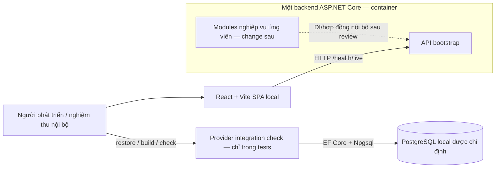

# Thiết kế foundation local

Trạng thái: Proposed, chưa triển khai. Scope theo [proposal](proposal.md), hành vi theo [spec FND-01–08](specs/local-runtime-foundation/spec.md). Dùng Mermaid mức nhẹ đã được người dùng chọn, không hỏi lại hình thức trình bày.

## Context

Repo hiện có planning/quy trình/discovery; chưa có project ứng dụng. Chủ dự án tập trung một tháng, đích MVP nghiệm thu nội bộ. Foundation là phần đầu tuần 1; các context nghiệp vụ trong [discovery](../../../Docs/discovery/overview.md) vẫn Candidate.

File local `Docs/ClinicFlow_Demo_v2.html` mới hiện có được đọc tham khảo ở mức metadata/bootstrap: script local storage và role owner/lead/staff không thay quyết định mới về Medical Lead/Team Lead. File chưa được Git theo dõi và không thuộc checkpoint đề xuất. Không chạy/chuyển mã hoặc sửa file này trong foundation; baseline UI chi tiết cần review riêng.

## Goals / Non-Goals

**Goals:** một API host + SPA local có checks tái lập; kiểm chứng bộ SDK/provider bằng PostgreSQL thật; cấu hình local không lộ secrets; có actual evidence.

**Non-Goals:** auth người dùng/phân quyền nghiệp vụ, bảng bệnh nhân/y lệnh, importer, engine lịch, dashboard hoàn chỉnh, domain modules, production migrations hoặc deployment. Liveness không là database readiness, clinical approval hoặc MVP acceptance.

## Decisions

### 1. Tái sử dụng baseline, giới hạn bootstrap

Giữ ASP.NET Core 11/net11.0, React/Vite strict TypeScript và PostgreSQL của `openspec/config.yaml`. Giữ một backend modular monolith; không dựng layer/module rỗng cho mọi entity ứng viên. Lựa chọn tạo tất cả modules ngay được hoãn vì ownership chưa được review; dùng API bootstrap và test-only provider context cho phần đủ rõ.

| Artifact dự kiến | Ownership / layer | Nội dung |
| --- | --- | --- |
| `src/backend/Api/ClinicFlow.Api.csproj`, `Program.cs` | API composition root; chưa thuộc context nghiệp vụ | Host, cấu hình development, DI HTTP, liveness/OpenAPI/CORS; không chứa persistence nghiệp vụ |
| `src/backend/Api/Bootstrap/` | API | Extension `AddFoundationApi`, `MapFoundationEndpoints`; response/HTTP mapping tối thiểu |
| `src/frontend/` | Frontend | App shell, API base URL công khai, health client và trạng thái kết nối/thử lại |
| `tests/backend/ClinicFlow.Api.Tests/` | API test | WebApplicationFactory kiểm tra health/OpenAPI/CORS và response tối thiểu |
| `tests/backend/ClinicFlow.Persistence.Tests/` | Infrastructure integration test, không là production layer/module | Test-only `ProviderProbeDbContext` không entity; kiểm tra CanConnectAsync qua EF/Npgsql |
| `global.json`, cấu hình package/lockfile, `.config/dotnet-tools.json` khi cần | Tooling ngoài domain | Pin phiên bản, SDK và tool local tương thích; không đổi global machine config |
| Hướng dẫn chạy và evidence dưới `Docs/` | Tài liệu vận hành local | Lệnh, cấu hình placeholder, actual result và phần chưa chạy |

Không có aggregate/domain service/repository mới: change không có use case nghiệp vụ hoặc persistence state. Domain/Application/Infrastructure của **Bounded Context** chỉ tạo khi context được review và có use case thực; ghi N/A có lý do, không dùng folder rỗng như bằng chứng Clean Architecture đã được kiểm chứng toàn hệ thống.

### 2. Kết nối tối thiểu và API composition root

`Program.cs` chỉ gọi đăng ký/bootstrap và map endpoint. `AddFoundationApi` đăng ký OpenAPI và CORS Development từ origin cụ thể; `MapFoundationEndpoints` map `GET /health/live` và tài liệu OpenAPI theo môi trường. Không có `AddSchedulingModule` hoặc module registration nghiệp vụ mới.

- Host và SPA là hai tiến trình chạy local; host là backend duy nhất, không có microservices.
- Mũi tên test -> PostgreSQL là kiểm tra provider; host chưa có production DbContext hoặc database readiness.
- Context ứng viên nằm trong backend tương lai; đường nét đứt là phần dự kiến, không là deployable service mới.
- PostgreSQL development cần được chuẩn bị và chỉ định trước provider check; chưa giả định máy đã có server chạy.

HTTP contracts mới: `/health/live` trả JSON `{ "status": "healthy" }`; `/openapi/v1.json` chỉ ở Development. Liveness không truy vấn database. Default development dùng loopback; URL/port được ghi một chỗ trong launch/env mẫu. CORS chỉ cho origin SPA cấu hình cụ thể, không credentials/wildcard.

Frontend shell hiển thị “Đã kết nối” hoặc thông báo mất kết nối dễ hiểu và nút “Thử lại”. Health client nhận base URL, có timeout hữu hạn/cancellation, xử lý lỗi HTTP/network; không nhúng cấu hình backend hoặc token. Không tự lấy dashboard/localStorage HTML demo làm dữ liệu ứng dụng.

### 3. Provider stable được xác minh theo metadata

Ngày 12/11/2026 đã đọc lại nguồn primary: [.NET 11 release](https://devblogs.microsoft.com/dotnet/announcing-dotnet-11/), [Npgsql EF 11 đang phát triển](https://www.npgsql.org/efcore/release-notes/11.0.html), [Npgsql EF 10.0.3 package/dependencies](https://www.nuget.org/packages/Npgsql.EntityFrameworkCore.PostgreSQL/10.0.3).

Npgsql EF 10.0.3 có target net10.0 và package metadata cho phép framework cao hơn, phụ thuộc EF Core/Relational `>=10.0.4,<11.0.0`, Npgsql `>=10.0.3`. Do provider 11 còn prerelease, tiếp tục cặp EF Core 10/Npgsql EF 10 stable trên net11.0; chọn pin patch stable thỏa dependency khi apply và ghi vào manifest. Không dùng 10.0.3 cho EF Core chỉ vì provider là 10.0.3.

Đây là xác minh release/dependency metadata; restore/build và check PostgreSQL thật vẫn phải chạy mới có bằng chứng runtime. Trước scaffold recheck package availability; nếu cần đổi ORM major thì cập nhật planning/impact cùng cả cặp, không đổi ngầm. Pin SDK 11 exact/roll-forward policy và tool/package/lockfile trong workspace; SDK thiếu được chuẩn bị local với PATH theo tiến trình, không đổi máy ngầm.

### 4. PostgreSQL check giữ nguyên dữ liệu

`ProviderProbeDbContext` chỉ trong test assembly, không DbSet/entity/mapping/migration, không được API tham chiếu/đăng ký. Nó nhận connection string test từ environment local, gọi `Database.CanConnectAsync` có cancellation với database phát triển đã được chỉ định. Check không tạo/xóa database/table/schema và không migrate/seed. PostgreSQL schemas/DbContexts/migrations production: chưa có thay đổi; sẽ thuộc Infrastructure của context thực trong change sau.

Nếu database hoặc cấu hình chưa sẵn sàng, ghi Failed/Not Run đúng kết quả và giữ task tương ứng chưa Done. Không dùng EnsureDeleted/EnsureCreated, EF InMemory hoặc tự chọn database khác để làm kết quả đạt. Credentials không được in lại trong test output; log/evidence chỉ giữ thông tin lỗi cần xử lý đã loại secrets.

### 5. Kiểm tra phù hợp thay đổi

API bootstrap được kiểm tra bằng API integration tests (health/OpenAPI theo environment, CORS origin được phép/bị từ chối); chưa có Application use case để tạo unit test nghiệp vụ giả. Health client có unit tests cho lỗi/timeout/cancellation và component behavior tests cho thử lại; dùng xUnit/WebApplicationFactory ở backend và Vitest/React Testing Library ở frontend theo baseline.

Backend restore/build/test/format và frontend install từ lockfile/typecheck/lint/test/build phải có kết quả thật. Provider check tách rõ khỏi API tests nhưng là điều kiện đóng foundation. Review dependency/layout giữ test-only provider khỏi API và không tự sinh module; không tuyên bố đã kiểm thử ranh giới Domain/Application chưa tồn tại.

## Risks / Trade-offs

- [SDK 11/PostgreSQL chưa sẵn sàng] -> Kiểm kê trước apply, chuẩn bị local trong scope đã có; giữ Not Run khi chưa thực thi, không retarget.
- [Khung chỉ có health bị coi MVP đã hoàn thành] -> Giữ change foundation nhỏ, phân biệt liveness/provider/runtime với nghiệm thu EP01–08.
- [Tạo domain modules theo bản nháp] -> Hoãn module/schema cho change nghiệp vụ sau review ownership; backend host vẫn một.
- [Secrets bị đưa vào SPA/log] -> Chỉ public API URL ở frontend, env/user-secrets cho test DB, placeholder/ignore và review output.
- [Provider metadata đúng nhưng runtime lỗi] -> Restore/build và PostgreSQL integration thật trước đóng task.
- [HTML demo thay đổi từ công việc khác] -> Giữ nguyên file, chưa suy ra roles/UI/optimizer trong đó là yêu cầu được chốt.

## Migration Plan

Change tạo source/config local mới, không có production data migration. Trước apply cần đúng planning commit trên `main` và review scope. Khi cần khôi phục bootstrap, chỉ xử lý các file của change sau đối chiếu diff; không xóa Docs, secrets, database hoặc thay đổi do người dùng làm song song. Không push/deploy/publish trong change.

## Open Questions

- SDK 11/PostgreSQL local và exact package patches cần được kiểm kê/chốt tại preflight implementation, chưa là prerequisite cho việc soạn planning.
- Đường dẫn runtime/database local có thể được chuẩn bị theo hướng dẫn sau khi implementation được phép; không cần credentials từ người dùng trong tài liệu.
- Git checkpoint của planning chưa có quyền commit mới. Các gate G1–G4 đúng scope foundation chưa được coi đã đạt bởi file này.
- Auth/identity, owner bounded context, dữ liệu/SOP thực tế và UI baseline thuộc change nghiệp vụ tiếp theo; không chặn authoring foundation.
