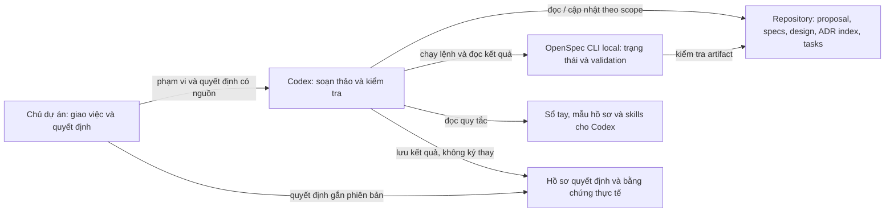

# Thiết kế P0 — chuẩn hóa công cụ và hồ sơ quy trình solo

| Thuộc tính | Giá trị |
| --- | --- |
| Trạng thái | Draft — đặc tả chi tiết theo phương án đã chốt; chưa phê duyệt riêng thiết kế này hoặc thực hiện apply |
| Cơ sở | DEC-SDP-SOLO-001 trong [proposal](proposal.md), [roadmap](execution-plan.md), năm delta specs |
| Phạm vi triển khai | P0.02–P0.07; chuẩn hóa công cụ, hướng dẫn và biểu mẫu cho toàn bộ quy trình |
| Phạm vi chưa triển khai | P1–P8 của sản phẩm, phân tích tài liệu khách hàng, scaffold app, CI/Production |
| Sơ đồ | Mermaid mức nhẹ theo lựa chọn của người dùng trong cuộc trao đổi; không phải strict C4 |

Đọc nhanh: mục Decisions mô tả sáu quyết định; [tasks](tasks.md) là danh sách thực hiện P0 theo thứ tự. Specs là hợp đồng chi tiết cho các kiểm soát tương lai; các tình huống release/incident không khẳng định đã có hệ thống Production.

## Context

Repository hiện có `AGENTS.md`, cấu hình/schema OpenSpec, 16 skills, hai tài liệu nghiệp vụ đầu vào và proposal/roadmap đã được duyệt. Git local ở `main`, origin đã kết nối, chưa có commit. OpenSpec CLI 2.0.0 chạy được; máy có SDK .NET 10.0.102 và 10.0.301, chưa có SDK 11. Không cần cài SDK hay dependency ứng dụng để làm P0.

Các vấn đề đã quan sát:

1. Artifact `adr` dùng `adr/**/*.md`, trong khi instructions cho phép để ADR rỗng và tasks lại phụ thuộc vào nó. Glob cũng có thể nhận tài liệu phụ mà không có một quyết định thật.
2. Một số skills gọi AskUserQuestion/TodoWrite/Task tool/Skill tool hoặc tham chiếu `.claude` và OpenCode. Việc đổi tên thư mục không tự chuyển các cách gọi này sang Codex.
3. Checkpoint Git hiện yêu cầu hỏi commit giữa mỗi artifact và yêu cầu proposal có trên main trước apply. Cần giữ ranh giới cho phép thao tác Git, đồng thời cho phép lập bộ tài liệu local đã được giao mà không hỏi lại từng file.
4. Chưa có sổ tay quy trình, mẫu hồ sơ và kiểm chứng workflow để đưa quy tắc đã chốt vào sử dụng thực tế.

### Ranh giới và quyền sở hữu

Tất cả artifact của change này thuộc tooling/tài liệu quản lý dự án, ngoài các lớp runtime Domain/Application/Infrastructure/API/Frontend. Không tạo bounded context nghiệp vụ, aggregate, repository C#, DI registrations, `Program.cs`, DbContext, schema PostgreSQL, migrations, API hoặc UI trong P0. Các mục đó không áp dụng cho thay đổi công cụ này; modular monolith + Clean Architecture + DDD giữ nguyên trong cấu hình.

### Phạm vi và nguồn của năm specs

Các ghi chú scope/nguồn đặt trong design để không bị mất khi OpenSpec archive chỉ đồng bộ requirement blocks. Tất cả requirement của bộ quy tắc được chuẩn hóa thành công cụ, sổ tay hoặc mẫu ở P0; thực hiện chúng trên sản phẩm thật thuộc các change P1–P8 sau này.

| Capability | Nguồn chính | Giới hạn của lần triển khai P0 |
| --- | --- | --- |
| solo-delivery-governance | DEC-SDP-SOLO-001; roadmap mục 2–4, 6, 8 | Không tự ghi G1–G7 đã đạt |
| requirements-and-change-control | Roadmap mục 4–8; SOP-01/02/07/11 | Chưa phân tích khảo sát/EPICS hoặc chốt MVP sản phẩm |
| architecture-and-development-discipline | Roadmap P0, R05–R10/R17, mục 9 | Chỉnh tooling/hướng dẫn; tình huống code là hợp đồng kiểm soát tương lai |
| verification-and-release-control | Roadmap P6–P7, R12–R16; SOP-06/07/08 | Soạn hồ sơ/checklist; chưa chạy tests ứng dụng hoặc triển khai môi trường thật |
| operations-and-process-improvement | SDP VIII–X; roadmap P8, mục 12–14 | Không tạo incident, deployment hoặc KPI giả |

### Sơ đồ quan hệ của workflow dự kiến

- Đây là sơ đồ quan hệ công cụ và hồ sơ, không mô tả topology triển khai ứng dụng.
- CLI chỉ kiểm tra trạng thái/cấu trúc; chất lượng nội dung và phê duyệt cần bằng chứng riêng.
- Hồ sơ có thể chứa đầu ra checks hoặc quyết định thật; nội dung mẫu giữ trạng thái chưa thực hiện.
- GitHub chỉ là remote đã liên kết; sơ đồ không thêm luồng push, CI hoặc deployment tự động.
- Phần sổ tay và workflow điều chỉnh là thiết kế tương lai của P0; repository hiện tại chưa được sửa theo thiết kế này.

## Goals / Non-Goals

**Goals:**

- Giữ quyết định solo đã chốt thành hướng dẫn có thể thực hiện và kiểm chứng.
- Hoàn thành được workflow không cần ADR mà không làm giả quyết định.
- Dùng đúng tool Codex, giảm hỏi lại quyết định còn hiệu lực, bảo toàn giới hạn hành động Git.
- Có ít tài liệu chính, record đủ kiểm chứng và pilot workflow tích cực/tiêu cực.
- Chuẩn hóa năm năng lực trong proposal thành policy/checklist; chưa thực hiện các giai đoạn sản phẩm tương ứng.

**Non-Goals:**

- Xây hệ thống quản trị hoặc engine phê duyệt mới, tự động hóa mọi gate hay bổ sung dịch vụ.
- Nâng phiên bản OpenSpec, cài framework/runtime ứng dụng, tạo database hoặc triển khai remote.
- Phê duyệt G1–G7, làm UAT khách hàng, tạo số liệu vận hành, hoặc đánh dấu 59 task roadmap đã xong.

## Decisions

### D1 — Một sổ tay và một bộ mẫu dùng chung

Tạo ba tài liệu chính khi apply:

| Đường dẫn dự kiến | Nội dung | Trách nhiệm |
| --- | --- | --- |
| `Docs/process/handbook.md` | Chỉ mục, POL-01/02, SOP-01–12, DoR/DoD, R01–R18, nhịp cải tiến và liên kết specs | Nguồn vận hành chính cho chủ dự án và Codex |
| `Docs/process/templates.md` | Các mẫu charter/scope/estimate/risk, yêu cầu/traceability/change request, design review, gate/exception, test/defect/UAT, release/deploy/rollback/handover, incident/KPI/audit | Trường dữ liệu bắt buộc, trạng thái mẫu chưa thực hiện |
| `Docs/process/records.md` | Chỉ mục record thật, append theo ID, scope, revision và nguồn quyết định/kết quả | Bằng chứng thực hiện, không sao chép mẫu thành hồ sơ đã duyệt |

Evidence dài đặt dưới `Docs/process/evidence/` khi phát sinh, có redaction và liên kết từ record. Mỗi Markdown artifact giữ companion glossary reference theo skill; chỉ mục trỏ tới ba tài liệu chính để người dùng không phải đọc các file phụ. Không tạo 12 SOP rời ngay từ đầu; so với cách đó, sổ tay gộp ít file nhưng cần anchor/ID ổn định để dễ tra cứu.

### D2 — Artifact tổng kết ADR có đường dẫn xác định

Đề xuất thay `generates` của artifact ID `adr` thành `adr-index.md`, giữ dependency `design -> adr -> tasks`. Template index có hai kết luận hợp lệ:

- `Not Applicable`: không có quyết định kiến trúc đáng kể, có lý do theo phạm vi.
- `Decisions Recorded`: liệt kê các ADR thật trong `adr/NNNN-*.md`, status và liên kết.

Các ADR thật dùng MADR minimal và chỉ ghi Accepted khi có quyết định tương ứng. Index không tự chấp thuận ADR hoặc gate. `adr/` rỗng, README hoặc glossary reference không được thay thế index. Chi tiết lựa chọn và trade-off ở [ADR-0001](adr/0001-explicit-adr-completion-index.md), hiện Proposed.

Thay đổi này không sửa parser của OpenSpec và không thêm loại artifact không được hỗ trợ. CLI vẫn dùng sự tồn tại của file; cần checklist kiểm tra nội dung index trước khi công bố đủ điều kiện. Các file đồng hành không có tên `adr-index.md`, vì vậy không thể mở khóa bằng chính glob cũ sau migration.

### D3 — Tách ba trạng thái độc lập

| Lớp | Nguồn kết luận | Ý nghĩa |
| --- | --- | --- |
| Artifact hiện diện | `openspec status` và đường dẫn được resolve | Đủ đầu vào theo schema; không khẳng định đúng nội dung |
| Kiểm chứng nội dung | Spec scenarios, checks và self-review có output thật | Có kết quả kiểm tra; Failed/Not Run vẫn được giữ đúng |
| Quyết định chuyển bước | Gate record của chủ dự án hoặc người phía khách hàng đúng thẩm quyền | Phạm vi, revision, quyết định, ngoại lệ và thời điểm cụ thể |

Mẫu gate hỗ trợ Not Started/In Review/Approved/Rejected/On Hold/Approved with Exception/Superseded. Mẫu exception ghi rule, impact, compensation, owner, thẩm quyền, hạn và corrective task. Một **Quality Gate** chỉ tiếp tục cho đúng phiên bản; sửa baseline, hết hạn ngoại lệ hoặc đổi artifact release kích hoạt xem lại phần bị ảnh hưởng.

Không thêm approval engine: dùng Markdown record và kiểm tra thủ công/fixtures. Ưu điểm là đơn giản cho một người; nhược điểm là không có hệ thống cưỡng chế toàn bộ, cần kỷ luật lưu bằng chứng và audit mẫu.

### D4 — Điều chỉnh skills theo khả năng Codex

Kiểm kê toàn bộ `.agents/skills/` và đối chiếu `.agents/commands/` là tài liệu tham chiếu, không giả định chúng tự đăng ký command cho Codex. Khi sửa skills, dùng workflow skill-creator để giữ metadata, nội dung và resource nhất quán.

| Mẫu hướng dẫn cũ | Hướng xử lý dự kiến |
| --- | --- |
| AskUserQuestion | Dùng khả năng hỏi người dùng hiện có; suy ra change từ ngữ cảnh đã xác định, chỉ hỏi khi thực sự mơ hồ |
| TodoWrite | Dùng cơ chế theo dõi task có sẵn hoặc trạng thái/checklist; không giả có tool |
| Task tool / Skill tool trong archive/sync | Thực hiện workflow liên quan trực tiếp hoặc dùng khả năng delegation thật nếu được yêu cầu; không ép subagent cho luồng solo |
| Path `.claude` hoặc named agent chưa có runtime | Ghi khả năng thực tế; sửa tham chiếu chỉ khi có cách dùng đúng, không coi đổi path là đã cấu hình agent |
| Workflow bulk/council cần runtime chưa sẵn sàng | Giữ ngoài luồng mặc định, đánh dấu giới hạn, không tự chạy hoặc xóa mất hướng dẫn gốc |

Giữ các yêu cầu phê duyệt có lý do theo scope/rủi ro, chỉ bỏ các câu hỏi lặp lại mà quyết định người dùng đã trả lời. Không chuyển một skill không sẵn sàng thành “đã hỗ trợ” chỉ bằng cách thay tên tool trong văn bản.

### D5 — Git local có checkpoint rõ và không tự commit

Trong P0 giữ mô hình hiện tại: planning có thể được soạn tiếp trên `main` trong working tree khi đã được giao; trước apply cần proposal/planning hiện hành được commit trên `main`, và archive từ `main` sau khi phần triển khai liên quan được tích hợp. Việc tạo commit/branch/merge/push vẫn cần chỉ dẫn người dùng; local diff + self-review thay thế yêu cầu PR mặc định cho solo.

Không bắt commit giữa từng artifact. Nếu thiếu checkpoint trước apply, báo một lần scope và điều kiện thiếu, không tự commit hoặc nâng trạng thái thành đủ điều kiện. Nếu sau này có branch protection/PR workflow thật, phải điều chỉnh rõ policy trước khi áp dụng. Ghi hash/revision cho bản được kiểm tra; recheck working tree khi nội dung thay đổi.

### D6 — Pilot workflow bằng fixtures có kiểm soát

Chuẩn bị một bộ kiểm chứng nhỏ cho tooling, không scaffold test projects của ứng dụng. Dùng thư mục fixture tạm trong workspace, root được chỉ định rõ, cleanup theo danh sách đường dẫn xác minh; không sửa/xóa tài liệu người dùng hoặc `.git` của dự án.

| Nhóm kiểm chứng | Kết quả cần chứng minh |
| --- | --- |
| ADR đáng kể / không đáng kể | Index mở dependency đúng với ADR thật hoặc kết luận không áp dụng có lý do |
| Chỉ có file phụ | Glossary reference/README không đủ thay artifact chính |
| Thiếu input / malformed index | Được báo là chưa đủ nội dung, dù CLI có thể báo file đã tồn tại |
| Phê duyệt, ngoại lệ và version | Template/checklist không biến thiếu quyết định, ngoại lệ hết hạn hoặc bản cũ thành Approved cho bản mới |
| Thiếu commit và tool không có | Chỉ báo điều kiện thiếu, không tạo Git changes ngoài scope hoặc giả output tool |
| Năm specs | Có mapping sang các mục sổ tay, mẫu hồ sơ và bằng chứng kiểm chứng thích hợp |

Với check có lệnh, lưu command/exit code/output đã redaction; với review thủ công, lưu bước và actual result. Không gọi kết quả soạn specs là kết quả chạy pilot. Sau các kiểm tra liên quan đạt, không mở rộng vô hạn sang tests ứng dụng chưa có scope.

## Risks / Trade-offs

| Rủi ro | Biện pháp và giới hạn |
| --- | --- |
| CLI báo file done nhưng index sai nội dung | Checklist nội dung và fixtures tiêu cực; tách kết quả CLI khỏi gate decision |
| Sửa schema làm các change cũ mất trạng thái | Lập inventory active changes, bổ sung index trung thực trước khi chuyển schema, không sửa source OpenSpec |
| Companion Markdown bị tính nhầm artifact | Đường dẫn index xác định; kiểm tra exact spec.md và ADR thật, không dùng companion để chứng minh nội dung |
| Sổ tay dài, người dùng quá tải | Ba tài liệu chính, có chỉ mục; final update chỉ trỏ phần cần quyết định ở bước hiện tại |
| Skills bị mất phần tùy chỉnh khi update | Không chạy `openspec update` hay regenerate hàng loạt; sửa có phạm vi, giữ bản trước và so diff |
| Policy Git mới chưa áp dụng nhưng được tưởng là đã chạy | Ghi trạng thái thiết kế Draft và checkpoint thiếu; không apply hay sửa skills trong bước lập kế hoạch này |
| Self-review có giới hạn độc lập | Nêu đúng vai trò, findings và tests; không tuyên bố đã có reviewer độc lập |

## Migration Plan

1. Chụp hiện trạng schema/templates/skills và active changes bằng inventory local có hash; chỉ thao tác trong phạm vi được cho phép.
2. Soạn handbook/templates/records với ID và links, để trống các trường quyết định/kiểm tra chưa có thật. Chuyển DEC-SDP-SOLO-001 bằng liên kết về nguồn, không tạo lại một chấp thuận khác.
3. Chuẩn bị template `adr-index.md`; bổ sung index cho các change hiện hành theo ADR thực tế trước khi đổi `generates`. Change này có ADR Proposed nên index không ghi Accepted.
4. Sửa schema và instructions liên quan đến ADR. Chạy validate schema và fixtures để chứng minh cả đường có ADR, không cần ADR và thiếu artifact chính.
5. Chuẩn hóa skills và Git policy, đối chiếu commands tham chiếu nếu có để tránh hai nguồn mâu thuẫn. Đồng bộ AGENTS/config bằng liên kết ngắn đến handbook.
6. Chạy bộ kiểm chứng P0, kiểm tra nội dung năm specs với bộ hồ sơ, ghi actual results. Mỗi nhiệm vụ chỉ Done khi có bằng chứng.
7. Tổng hợp self-review, các điều kiện chưa đáp ứng và phạm vi sẵn sàng. Chủ dự án chốt thiết kế/triển khai theo đúng bằng chứng, không tự nâng G1–G7 của sản phẩm.

Nếu cần khôi phục thay đổi tooling: dùng bản trước của schema/templates/skills cho đúng đường dẫn đã sửa; kiểm tra lại active changes theo schema cũ và giữ record mới như lịch sử. Không dùng `git reset --hard`, xóa tài liệu người dùng hoặc xóa index/ADR có quyết định thật chỉ để làm trạng thái xanh.

## Open Questions

- Môi trường Production, người xác nhận khách hàng, KPI target và bounded context sản phẩm chưa được xác định; thuộc P1–P8, không chặn đặc tả P0.
- Nơi lưu backup/evidence dài hạn chưa được chọn; P0 mô tả yêu cầu và cấu trúc local, không tự upload dữ liệu.
- Chưa có chấp thuận tạo commit cho checkpoint trước apply. Bộ planning hoàn chỉnh không thay thế điều kiện Git này.
- Các chi tiết thiết kế và ADR mới ở trạng thái Draft/Proposed; DEC-SDP-SOLO-001 chốt phương án tổng thể, không được giả là đã chấp thuận mọi chi tiết vừa viết.

## Kết quả kiểm tra bộ planning ngày 12/11/2026

| Kiểm tra đã thực hiện | Kết quả quan sát |
| --- | --- |
| `openspec validate establish-solo-development-process --type change --strict --json --no-interactive` | Valid, không có issues |
| `openspec schema validate intent-driven --json` | Schema hiện hành valid |
| `openspec doctor --json` | Root healthy |
| `openspec status --change establish-solo-development-process --json` | Đủ năm artifact theo schema |
| Đọc apply instructions, không thực hiện apply | CLI báo ready về artifact; 26 tasks, 0 complete, 26 remaining |
| Kiểm tra cấu trúc Markdown và traceability bằng script đọc file | 22 Markdown files, 5 capabilities, 21 requirements, 42 scenarios, 21 dòng mapping; không có links hỏng, ID trùng hoặc companion còn thiếu |
| Git working tree | Main chưa có commit; không có commit/push được tạo trong bước lập planning |

Kết quả trên chỉ kiểm chứng bộ tài liệu và trạng thái tooling hiện hành. Chưa sửa schema/skills theo thiết kế, chưa chạy pilot P0, chưa chạy tests ứng dụng và chưa ghi nhận gate triển khai nào đã đạt. Điều kiện Git trước apply vẫn cần được giải quyết theo chỉ dẫn của chủ dự án.
